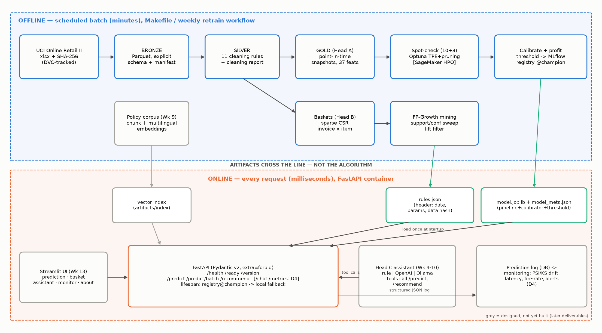

# Architecture



**Principle:** mining and training are expensive and run **offline**; serving is a lookup and runs
**online**. Only artifacts cross the line — never the algorithm. Full walkthrough and rationale:
[D2 report](reports/977_D2_Morgunova_DesignArchitecture.md).

## Offline (Make targets; weekly retraining workflow opens a PR, never deploys)

| Stage | Command | Output |
|---|---|---|
| Ingest (bronze) | `make data` | `data/bronze/transactions.parquet`, `data/manifest.json` |
| Clean (silver) | `make etl` | `data/silver/lines.parquet`, `cancellations.parquet`, `reports/cleaning_report.md` |
| Features (gold) | `make features` | `data/gold/retention.parquet`, `reports/feature_spec.md` |
| Data quality | `make dq` | pass/fail per layer |
| Head A | `make spotcheck tune train evaluate leakage` | `artifacts/model.joblib`, `model_meta.json`, MLflow runs + registry |
| Head B | `make rules-sweep rules rules-eval` | `artifacts/rules.json` |
| Head C | `make index` | `artifacts/index/` (chunks, embeddings, meta) from `docs/corpus/` |
| Monitoring reference | `make reference` | `artifacts/reference_profile.json`, `demo_customers.json`, `catalogue.json` |
| Assistant evaluation | `make assistant-eval` | `reports/metrics/assistant_eval.json` |
| Reports | `make reports` | `reports/977_D*.{md,html,pdf}`, `reports/figures/` |

## Online (FastAPI, `src/boreal_marche/api.py`)

| Endpoint | Purpose |
|---|---|
| `GET /health` | liveness — the process is up |
| `GET /ready` | readiness — model and rules loaded (503 otherwise) |
| `GET /version` | API version, git commit, model version and source, rules date and count |
| `POST /predict`, `/predict/batch` | calibrated P(return in 90 d) + proposed coupon action (human approves) |
| `POST /recommend` | top-k items, firing rule per item, strategy (`rules`, `rules+popularity`, `popularity_fallback`, `empty_basket`) |
| `GET /customers`, `/customers/{ref}/features` | pseudonymised demo customers (feature-store stand-in) |
| `GET /products` | catalogue search by SKU or name |
| `POST /chat`, `/chat/stream`, `GET /chat/providers` | Head C: guardrails → provider picks a tool → tool calls this API → cited answer (JSON or SSE) |
| `GET /metrics` | Prometheus counters/histograms + traffic-light gauges |
| `GET /monitoring/report`, `/alerts`, `/timeseries` | drift (PSI/KS), prediction drift, data quality, ops, rule fire-rate; alert history |

Artifacts are loaded once in the lifespan hook: the model from `models:/boreal-retention@champion`
with fallback to `artifacts/model.joblib` (containers use the file); rules, retrieval index, reference
profile, demo customers and catalogue from `artifacts/`. Request and response models are Pydantic v2
with `extra="forbid"`. Every request, prediction, recommendation and chat turn is logged to SQL
(`monitoring/store.py`); a background thread evaluates the checks every 60 s and raises alerts on level
changes (`docs/MONITORING.md`).

## Deployment (D4)

```
PR ─► ci.yml: ruff · mypy · pytest+coverage · DQ · assistant tool-choice · docker build + container smoke · gitleaks
merge ─► cd.yml: OIDC → role BorealGithubDeploy → ECR boreal-api:<sha>, boreal-ui:<sha> → App Runner → smoke test (/version == sha)
Mondays ─► retrain.yml: ETL → train → rules → promotion + fairness gate → pull request (human merges)
hourly ─► monitor.yml: GET /monitoring/report → GitHub issue when red or down
local ─► docker/compose.yml: api + frontend (Streamlit) + Postgres + Ollama
```

Runbook: [docs/runbooks/AWS_APPRUNNER_DEPLOY.md](docs/runbooks/AWS_APPRUNNER_DEPLOY.md) · IAM:
`infra/aws/` · traffic simulation: `loadtest/locustfile.py`, `scripts/simulate_traffic.py`.

## Code map

```
src/boreal_marche/
  config.py            typed params.yaml + paths
  data/ingest.py       bronze + manifest + checksum
  data/cleaning.py     silver rules + cleaning report
  data/quality.py      data-quality assertion suite
  reskin.py            documented re-skin mapping
  features.py          point-in-time gold snapshots + FEATURE_SPEC
  retention/           models, cv, spotcheck, tune, train, artifact, profit, evaluate, leakage, sm_train
  recommend/           baskets, mine, engine, evaluate
  retention/promote.py promotion + fairness gate for the retraining workflow
  registry.py          champion alias -> local fallback
  schemas.py, api.py   typed API, request logging, metrics
  assistant/           index (chunk + embed), tools, providers (rule/ollama/openai), guardrails,
                       service (orchestration + streaming), evaluate (golden + paraphrase sets)
  monitoring/          store (SQL log), reference, drift (PSI/KS report), alerts, backfill
  reporting/           figures and report builder (D1-D4)
frontend/              Streamlit interface (prediction, basket, assistant, monitoring, about; EN/FR)
loadtest/              Locust traffic simulation (normal + shifted cohort)
```
