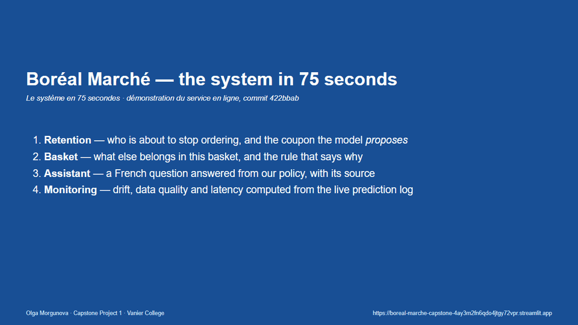
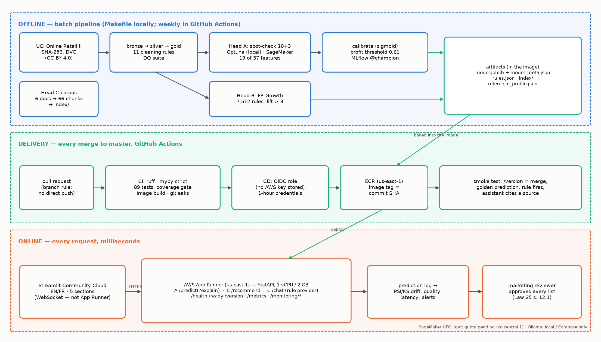

# Boréal Marché — Customer Intelligence Platform

[](https://github.com/OlgaMorgunova/boreal-marche-capstone/actions/workflows/ci.yml)
[](https://github.com/OlgaMorgunova/boreal-marche-capstone/actions/workflows/cd.yml)

**One reproducible data pipeline feeding three deployed, monitored and Law 25-governed models — a
retention-coupon decision, basket recommendations and a grounded bilingual assistant — for a Québec
online grocer.**



*75-second capture of the live system, recorded by [`scripts/capture_demo.py`](scripts/capture_demo.py) ([MP4](docs/media/demo.mp4)) · full walkthrough video: https://youtu.be/C_Qv7lu3cpY*

| Live | |
|---|---|
| Interface (EN/FR) | https://boreal-marche-capstone-4ay3m2fn6qdo4jtgy72vpr.streamlit.app |
| API documentation | https://padp32qm6p.us-east-1.awsapprunner.com/docs |
| Deployed version | https://padp32qm6p.us-east-1.awsapprunner.com/version (commit = head of `master`) |
| D6 presentation (15 min, recorded) | https://youtu.be/2bcNpRwMQxE |
| Demonstration | 75 s capture above · full walkthrough https://youtu.be/C_Qv7lu3cpY · [script](docs/DEMO_VIDEO_SCRIPT.md) |

The interface sleeps when unused — the first visit wakes it in about 30 s. The API runs on AWS App
Runner and is paused between grading windows to save cost.

Olga Morgunova · 420-977-VA AI Development Project (Capstone 1), Vanier College LEA.EU ·
Instructor: Steve Ataky, Ph.D.

## The problem

Every quarter the client sends a 15% coupon to every active customer; on the last held-out quarter
that policy **lost $55k**, mostly on loyal customers who would have ordered anyway. The system
predicts who is about to stop ordering, turns that probability into a profit-based coupon
*proposal* that a manager approves, suggests what else belongs in a basket, and answers the forty
recurring customer questions in French or English without inventing anything.

## Architecture



Everything expensive (cleaning, mining, tuning) runs offline; only artifacts cross into the API
image, so every request is a lookup. A merge to `master` runs CI, then CD authenticates to AWS with
**GitHub OIDC** (no stored keys), pushes an image tagged with the commit SHA, deploys it to App Runner
and smoke-tests the live service. Details: [ARCHITECTURE.md](ARCHITECTURE.md) and the
[final technical report](reports/977_D6_Morgunova_TechnicalReport.pdf).

## Results (held-out, temporal splits)

| Head | Metric | Result | Baseline |
|---|---|---|---|
| A — Retention | PR-AUC, test quarter 2011-09 | **0.847** [0.832, 0.863], calibrated (ECE 0.041), 19 features | 0.712 recency deciles · 0.673 "ordered in 60 days" rule · 0.607 dummy |
| A — Decision | Quarterly campaign profit vs coupon-to-everyone | **+$54k** (test quarter), **+$30k** (validation quarter) → **$120k–$217k a year** | today's blanket coupon: −$55k / −$23k |
| B — Recommendations | Hit-rate@5, temporal holdout | **0.145**, 92% of baskets served by a rule | 0.017 best-sellers (**8.6×**) |
| C — Assistant | Tool choice, 40 golden / 20 paraphrased questions | **97.5% / 95%** local LLM, 100% out-of-scope refused | keyword rules 100% / **35%** |
| Platform | API image · `/predict` warm p50 · tests | 823 MB · 4.8 ms · 89 tests, 82% coverage | D3 image 1,437 MB |
| Cost | Total AWS spend, Sep–Oct 2026 | **$3.05** | course target < $25 |

**Negative results, kept on purpose:** tuning added < 0.005 PR-AUC (the limit is the features, not
the algorithm); the first profit model made "contact nobody" optimal until I fixed its value
horizon; lapsing customers in the **top spend quartile** are proposed only 46% of the time vs 89%
overall — a fairness gap that is audited and, since v1.0, routed to a served human review list
(lifts it to 89% *if* the reviewer approves the whole list), **not solved by the model**; in mlxtend,
Apriori is ~116× faster than FP-Growth at this size. Every number here comes from
`reports/metrics/*.json`.

## Quickstart

**Docker (any OS)** — API, interface, Postgres and a local LLM:

```bash
git clone https://github.com/OlgaMorgunova/boreal-marche-capstone.git && cd boreal-marche-capstone
docker compose -f docker/compose.yml up --build -d     # API :8000/docs · UI :8501
python3 scripts/smoke_test.py --api http://127.0.0.1:8000 --ui http://127.0.0.1:8501
```

**Python only** (uv + CPython 3.11, the committed artifacts, no data download):

```bash
uv venv --python 3.11 .venv
uv pip install --python .venv -r requirements-dev.txt && uv pip install --python .venv -e . --no-deps
.venv/bin/python scripts/run.py test        # 86 pass, 3 skip until `make data` (Windows: .venv\Scripts\python)
.venv/bin/python scripts/run.py api         # http://127.0.0.1:8000/docs
.venv/bin/python scripts/run.py frontend    # second terminal: http://127.0.0.1:8501
```

**Rebuild everything from the raw data** (~15 min): `make all` (or `python scripts/run.py all`) downloads
the UCI file, refuses it if its SHA-256 differs from `params.yaml`, then cleans, builds features,
tunes, trains, mines rules and indexes the corpus. `make reports` regenerates every figure and PDF.
Windows, step by step from an empty machine: [docs/RUN_FROM_ZERO_WINDOWS.md](docs/RUN_FROM_ZERO_WINDOWS.md).
The test set is not re-scored on a fresh clone (test protection; `make evaluate ARGS=--force`
records an extra look). No secret is needed; optional variables are in `.env.example`.

## Documents

| Deliverable | Document |
|---|---|
| D7 — reflection (2 pages) | [977_Reflection_Morgunova.pdf](reports/977_Reflection_Morgunova.pdf) |
| D7 — defence brief: system inventory, readiness check, prepared answers to the question bank | [977_D7_Morgunova_DefenceBrief.pdf](reports/977_D7_Morgunova_DefenceBrief.pdf) |
| D6 — final technical report (consolidates D2–D5) | [977_D6_Morgunova_TechnicalReport.pdf](reports/977_D6_Morgunova_TechnicalReport.pdf) |
| D6 — executive summary, English + français | [977_D6_Morgunova_ExecutiveSummary.pdf](reports/977_D6_Morgunova_ExecutiveSummary.pdf) |
| D6 — presentation deck and recorded talk | [977_D6_Morgunova_Presentation.pdf](reports/977_D6_Morgunova_Presentation.pdf) · [video](https://youtu.be/2bcNpRwMQxE) · [speaking script](docs/PRESENTATION_SCRIPT.md) |
| D1–D6 (as submitted, tags `v0.1`…`v0.9.6`; this release is `v1.0`) | [reports/](reports/) |
| Governance and cards | [GOVERNANCE_LOI25.md](GOVERNANCE_LOI25.md) · [MODEL_CARD.md](MODEL_CARD.md) · [DATA_CARD.md](DATA_CARD.md) · [docs/MONITORING.md](docs/MONITORING.md) |

## Repository map

| Path | Contents |
|---|---|
| `params.yaml` | every window, cut-off, cost assumption, grid and seed |
| `src/boreal_marche/` | all business logic: `data/`, `features.py`, `retention/`, `recommend/`, `assistant/`, `monitoring/`, `api.py`, `cloud/`, `reporting/` |
| `tests/` | unit, API contract, golden prediction, data quality, monitoring, assistant guardrails, pipeline smoke |
| `artifacts/` | `model.joblib` + `model_meta.json`, `rules.json`, `index/`, `reference_profile.json`, `campaign_policy.json` |
| `reports/` | D1–D7 PDFs, `metrics/*.json` (all evidence), `figures/`, `src/` (report templates) |
| `docker/`, `.github/workflows/` | two images and the Compose stack; `ci.yml`, `cd.yml`, `retrain.yml`, `monitor.yml` |
| `frontend/`, `loadtest/` | Streamlit interface; Locust traffic simulation |
| `infra/aws/`, `docs/runbooks/` | IAM policies, bootstrap script, App Runner / SageMaker / budget-alarm runbooks |
| `docs/` | promotion and monitoring policies, presentation script, commit and tag plans |

## Data and licence

UCI Online Retail II (Chen, 2012, DOI 10.24432/C5CG6D, **CC BY 4.0**): real UK giftware
transactions **re-skinned** as Boréal Marché for a teaching scenario — public data, not client data.
The raw file is DVC-tracked and never committed. See [DATA_CARD.md](DATA_CARD.md).

## What I would do next

1. **Run the hold-out that is now built**: the API already draws a 10% hash-based hold-out of
   proposed customers (`action: holdout`); two quarters of it measure the save rate every dollar
   above assumes (20%), then an uplift model if the effect differs by customer.
2. **Measure the review list in use**: v1.0 serves the high-value review list (`GET /campaign`);
   what reviewers actually approve, and subgroup recall on backfilled labels, decide between the
   single threshold and the expected-value policy.
3. **Move serving to `ca-central-1`** (ECS Fargate; App Runner is not offered in Canada) and the
   prediction log to Postgres before any real customer data.
4. **Run the SageMaker HPO job** — implemented and dry-run tested; the spot-instance quota request
   is still open, so all tuning so far ran locally with Optuna.
5. **An onboarding rule for one-order customers**, whom the model cannot rank (PR-AUC 0.59).
