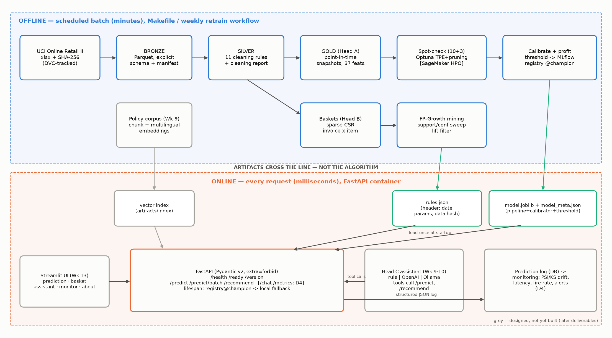

# D1 — Project Proposal and Charter
**Boréal Marché Customer Intelligence Platform** · Capstone Project 1

Olga Morgunova (individual project) · 420-977-VA AI Development Project · Instructor: Steve Ataky, Ph.D. · Vanier College, LEA.EU · Repository tag `v0.1` · KLO 1

## 1. Problem statement — in the client's terms

Boréal Marché (fictional Québec online grocery and specialty retailer; ~5,000 registered customers,
~4,000 active SKUs, ~25,000 orders a year across Québec, Ontario and the Maritimes) runs three parts
of its business on intuition. Each is a separate, measurable problem:

| # | Today | Why it costs money | What we will measure |
|---|---|---|---|
| 1 | **Retention.** A 15% coupon goes to *every* customer *every* quarter. | Margin is given away on customers who would have ordered anyway, while customers who are quietly lapsing get the same untargeted offer. | Campaign profit per quarter vs. "coupon to everyone" (CAD), using stated cost assumptions |
| 2 | **Cross-sell.** The "you might also like" strip was hard-coded by an intern eight months ago. | It reflects no purchasing behaviour; every basket is a missed attach opportunity. | Hit-rate@5 of recommendations on future baskets vs. a bestseller list |
| 3 | **Customer support.** Two employees answer the same ~40 questions (delivery, returns, allergens, privacy) all day, in two languages. | Two people on repetitive work; slow answers; inconsistent policy statements. | Share of golden-set questions answered correctly and grounded; 100% refusal on out-of-scope |

The platform answers each with one *head* on one shared data pipeline: **A — Prédiction** (will
this customer order again in the next 90 days?), **B — Recommandation** (given this basket, what next?),
**C — Assistant** (grounded bilingual answers that call A and B through our own API).

## 2. Dataset selection and justification

**Choice: UCI Online Retail II** (Chen, 2012; DOI 10.24432/C5CG6D; licence **CC BY 4.0**, which
permits educational use and redistribution with attribution). One workbook, two yearly sheets,
1,067,371 transaction lines, 2009-12-01 → 2011-12-09, 53,628 invoices,
5,305 stock codes, 5,942 customer ids. File SHA-256 `bcbe73b35f5b…`
(full value in `data/manifest.json`), 43.5 MB.

| Required property | Present? | Evidence |
|---|---|---|
| Multi-item transactions | Yes | 25.4 lines per clean invoice on average → association rules are meaningful |
| Timestamps | Yes | Minute-level `InvoiceDate` over 2 years → observation/label windows and a temporal holdout |
| Customer identifier | Yes, partially | `Customer ID` present on 776,577 of 1,003,338 clean lines; guests (22.6%) are unusable for Head A but valid baskets for Head B |

**Known quality issues** (first EDA, all handled by documented rules in D2/D3): cancellations
(invoices prefixed `C`, negative quantities), non-positive prices, service/fee codes (`POST`, `DOT`,
`M`, `BANK CHARGES`, `AMAZONFEE`, test and gift-voucher codes), the same SKU under several
descriptions, extreme bulk lines (e.g. an 80,995-unit order cancelled the same day), missing customer
ids, and — found during this proposal — **the two yearly sheets overlap for 2010-12-01…09**, so naive
concatenation double-counts 22,523 lines.

**Honest provenance.** The data are a UK giftware wholesaler's real transactions, *re-skinned* as
Boréal Marché for a pedagogical scenario: countries map to delivery regions (UK → QC, continental
Europe → ON, Ireland/islands → MARITIMES, rest → INTL), a keyword category is added, amounts are
labelled CAD without conversion. The mapping is in `DATA_CARD.md` and `src/boreal_marche/reskin.py`.
This is not proprietary client data and is never presented as such. Consequences we accept: the
catalogue is giftware, not groceries; many customers are small businesses (large baskets).
The raw file is DVC-tracked and never committed to Git; one command (`make data`) fetches it,
verifies the checksum and writes the manifest. Alternatives (Instacart, Olist, Dunnhumby) were not
needed: Online Retail II satisfies all three criteria and is the course default.

## 3. Proposed architecture — offline and online halves

*Figure 1 — Offline half (blue) runs on a schedule and produces artifacts; online half (orange) only
loads artifacts and answers requests. Grey components are designed now and built in later weeks.*

Mining and training are expensive and run offline; serving is a lookup. Only artifacts cross the
line: `model.joblib` + `model_meta.json` (Head A), `rules.json` (Head B), a vector index (Head C).
One FastAPI service exposes `/predict`, `/recommend` and `/chat`; one Streamlit interface and one
monitoring dashboard consume it.

## 4. Success metrics — targets fixed in advance

| Head | Metric (primary in bold) | Baseline it must beat | Target | Business translation |
|---|---|---|---|---|
| A | **PR-AUC on the held-out test snapshot** | Dummy prior; one-rule "ordered in last 60 days" | ≥ 0.62 and ≥ +0.05 over the rule | — |
| A | Brier score / reliability after calibration | Uncalibrated model | ECE ≤ 0.05 | Probabilities usable in a dollar calculation |
| A | Campaign profit at the chosen threshold | Coupon to everyone (status quo) and to nobody | > status quo, in CAD per quarter | Margin recovered |
| B | **Hit-rate@5** on a temporal holdout | Top-5 bestsellers | ≥ 2× popularity; coverage ≥ 40% of baskets | More relevant attach items |
| C | Tool-choice accuracy on a 40-question golden set (in CI) | Rule/keyword provider | ≥ 85%; 100% refusal on out-of-scope | Support workload deflected |
| Eng. | `/predict` p95 latency · image size · CI runtime | — | < 150 ms · < 1 GB · < 8 min | Cheap to run |
| Cost | Total cloud spend | — | < $12 (hard ceiling $25) | — |

If a head does not beat its baseline, that is reported as a finding, not hidden.

## 5. Scope

**In scope:** the three heads, reproducible ETL, experiment tracking and registry, typed API,
containers, CI/CD, a deployed interface and monitoring, Law 25 governance artifacts.
**Out of scope, and why:** real-time streaming ingestion (batch is enough for quarterly campaigns);
causal uplift modelling (no randomised coupon data exists — we model *propensity* and state the
limitation); collaborative filtering and deep recommenders (no ratings, sparse repeat purchase — see
D2); fine-tuning an LLM (RAG is cheaper and auditable); a mobile app; any real customer data or
contact.

## 6. Risk register

| # | Risk | Likelihood | Impact | Mitigation | Owner |
|---|---|---|---|---|---|
| R1 | **Data quality** — duplicates, cancellations, overlap between sheets distort features | High (confirmed) | High | Ordered cleaning rules with row counts, data-quality test suite in CI | Olga |
| R2 | **Leakage** — features computed across the label window give fake 0.95+ scores | Medium | High | Point-in-time feature code with unit tests; deliberate leaky experiment; test set touched once | Olga |
| R3 | **Cloud cost** — forgotten SageMaker endpoint or App Runner service | Medium | Medium | $10 budget alarm (Week 1), managed spot, `max_run` caps, teardown checklist, Render free tier for serving | Olga |
| R4 | **Scope creep** — three heads + full MLOps for one person | High | High | Skeleton first (stub API deployed by Week 5), STRETCH items only after D4; weekly scope check | Olga |
| R5 | Seasonality/drift — Q4 peak changes base rates between train and test | High | Medium | Quarterly cut-offs covering all seasons; calibration on a separate snapshot; report shift explicitly | Olga |
| R6 | Hosted-LLM privacy — personal data sent outside Québec | Low (design) | High | No personal data to hosted providers; local Ollama provider; Law 25 s. 17 review | Olga |
| R7 | Environment drift — host Python 3.14 vs. required 3.11; library upgrades | Medium (confirmed) | Medium | `uv`-managed Python 3.11, pinned ranges, Docker image, CI on 3.11 | Olga |
| R8 | Single point of failure — solo student illness/overload | Medium | High | 14 h/week budget with buffer weeks 7 and 13; early submissions of skeletons | Olga |

## 7. Team charter (individual project)

- **Role:** Olga Morgunova owns data, modelling, serving, operations and documentation.
- **Weekly time budget:** 14 h (2 h studio + 12 h project/homework; 2-11-5 ponderation = 210 h over
  15 weeks). Split ≈ 55% build, 20% evaluation, 25% documentation.
- **Working agreement:** work on short-lived branches, pull requests into `master` with green CI;
  self-review with a checklist (tests, numbers traceable to `reports/metrics`, no secrets) and a
  24-hour cooling-off before merging report text; AI-assistant output is reviewed line by line.
- **Cadence:** Monday plan (issues/milestones), Thursday studio checkpoint with the instructor,
  Sunday retrospective in `PLAN.md` (decision log).
- **Review:** peer review of the feature table (Week 3) and cold-start test by a classmate (Week 11).

## 8. Fifteen-week plan (mapped to the course milestones)

| Wk | Build task | Checkpoint / due |
|---|---|---|
| 1 | Repository, branch protection, tooling, budget alarm | Repository review |
| 2 | Ingestion (`make data`), cleaning report, **this proposal** | **D1 (10%)** |
| 3 | Point-in-time feature table + tests | Peer review of features |
| 4 | Spot-check harness: ≥ 8 families, 2 baselines | Spot-check report |
| 5 | Optuna, calibration, profit threshold; stub API deployed | **D2 (15%)** |
| 6 | SageMaker script mode + HPO, artifact + sidecar, endpoint torn down | Cost report |
| 7 | MLflow tracking, registry, promotion policy (buffer week) | Registry evidence |
| 8 | Association rules, serving engine, hit-rate evaluation | **D3 (15%)**, tag `v0.3` |
| 9 | Policy corpus (~15 pp.), index, tools; golden set of 40 | Golden set submitted |
| 10 | Three providers, guardrails, assistant evaluation | Evaluation table |
| 11 | API + containers complete, one-command stack | Cold-start test |
| 12 | CI/CD with OIDC, live URL | **D4 (15%)**, tag `v0.9` |
| 13 | Five-section interface (buffer week) | Live application link |
| 14 | Monitoring + drift, fairness audit, Law 25 file | **D5 (10%)** |
| 15 | Report, bilingual executive summary, deck, defence | **D6 (15%) + D7 (20%)**, tag `v1.0` |

## 9. Cloud cost plan and budget control

Ceiling **$25**, target **< $12**: SageMaker HPO on managed spot with 15-minute caps (≈ $0.05–0.50),
one real-time endpoint for < 1 h (≈ $0.10), S3 < $0.50, serving on Render's free tier or App Runner
paused outside demos, hosted-LLM evaluation on synthetic questions only (< $2). Region `ca-central-1`.
Training is local by default; managed training is used where the assignment requires evidence, and
its crossover point is analysed in D3. The HPO backend is a configuration switch (`local` / `aws` /
`azure`, `docs/CLOUD_OPTIONS.md`): SageMaker is the plan of record; Azure ML (Canada Central,
low-priority VMs) is prepared as a fallback to be used only with the instructor's approval. Budget runbook: `docs/runbooks/AWS_BUDGET_ALARM.md`.

> **Control point — budget alarm evidence.** A $10 monthly cost budget with alerts at 50%, 85% and
> 100% forecast is part of this cost plan. Its configuration must be verified in the AWS console and
> the screenshot attached to this section before submission (steps in the budget runbook).

## 10. Sources and AI-tool use

Chen, D. (2012). *Online Retail II* [Dataset]. UCI Machine Learning Repository,
https://doi.org/10.24432/C5CG6D (CC BY 4.0). Course specification *Capstone Project 1* (Vanier
College, 420-977-VA). AI-assisted coding and drafting tools were used for code, tests and report
text; every section was reviewed, and all numbers were checked against the pipeline outputs.
Where AI-generated output had to be corrected is recorded in D3 §15.
