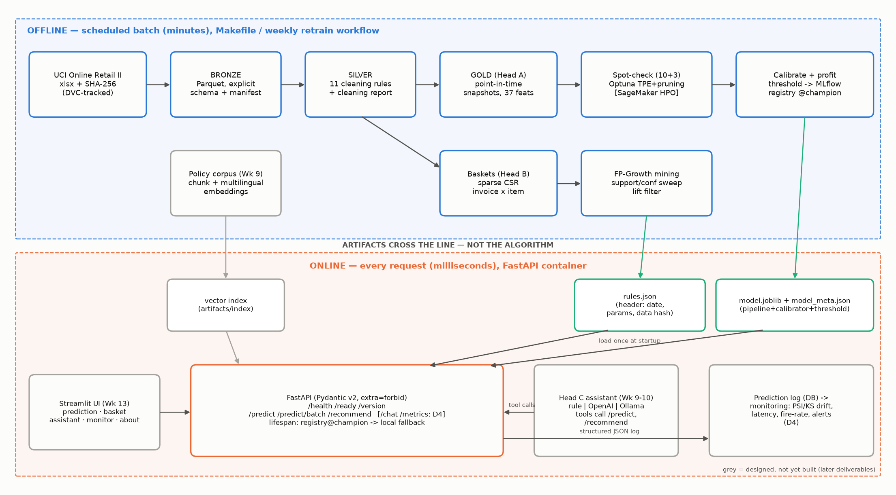
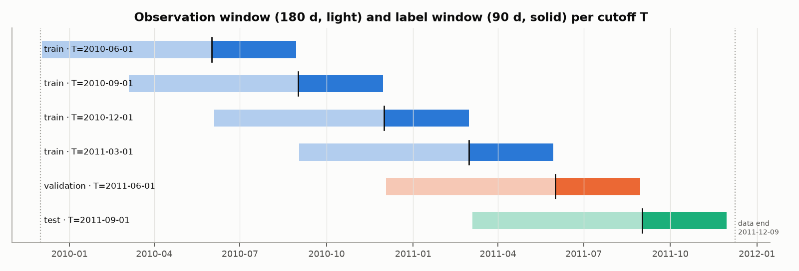
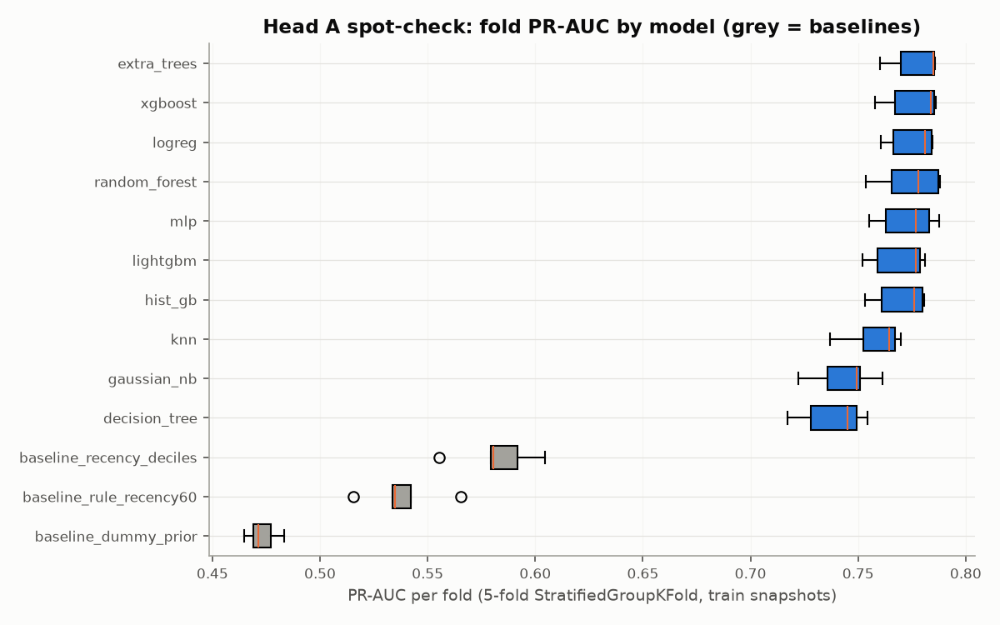

# D2 — Model Design and Architecture Report
**Boréal Marché Customer Intelligence Platform** · Capstone Project 1

Olga Morgunova (individual project) · 420-977-VA AI Development Project · Instructor: Steve Ataky, Ph.D. · Vanier College, LEA.EU · Repository tag `v0.2` · KLO 2 · Diagram also submitted as `reports/figures/architecture.png`

## 1. Summary

One data pipeline (bronze → silver → gold) feeds three heads. Head A predicts whether a customer
orders again within 90 days and turns the calibrated probability into a
profit-maximising coupon decision; Head B mines association rules offline and serves them from an
index; Head C (built in Weeks 9–10) answers policy questions with retrieval-augmented generation and
calls A and B as typed tools. The design separates everything expensive (cleaning, mining, tuning)
from everything on the request path (artifact lookups). The spot-check (§9) carries
**Extra trees and XGBoost** forward.

## 2. Architecture and walkthrough

*Figure 1 — Full architecture. Blue: offline, scheduled; orange: online, per request; aqua boxes are
the only artifacts that cross the line; grey components are designed here and built in D4–D5.*

**Walkthrough.** (1) `make data` downloads — or copies a local copy of — the UCI workbook, verifies
its SHA-256 against `params.yaml`, and writes both sheets verbatim to **bronze** Parquet with an
explicit schema plus `data/manifest.json` (source, DOI, licence, retrieval time, checksum, row
counts). DVC tracks the raw file; Git never sees it. (2) `make etl` applies eleven ordered cleaning
rules and emits the cleaning report; the result is **silver** (one row per clean line, re-skinned
region and keyword category). (3) `make features` builds **gold**: one row per (customer, cutoff) with
37 point-in-time features and the 90-day label. (4) Head A: spot-check → Optuna → final
fit → calibration and threshold on a separate snapshot → one joblib artifact with a metadata sidecar,
registered in MLflow with alias `champion`. (5) Head B: silver invoices → sparse invoice×item matrix
→ FP-Growth → lift filter → `rules.json` with a provenance header. (6) Head C: ~15 pages of policy
documents → chunks with metadata → multilingual embeddings → vector index. (7) The FastAPI service
loads the three artifacts **once at startup** (lifespan), exposes `/health` (liveness), `/ready`
(artifacts loaded), `/version` (API, commit, model and rules versions), `/predict`, `/predict/batch`,
`/recommend`, and later `/chat` and `/metrics`; every prediction is logged as structured JSON to a
database table that the monitoring dashboard reads.

| Artifact | Producer | Consumer | Contents |
|---|---|---|---|
| `data/manifest.json` | `data.ingest` | DQ suite, all runs (lineage tag) | source, licence, SHA-256, counts, schema |
| `reports/cleaning_report.md/json` | `data.cleaning` | D3, DQ suite | rows before/after per rule |
| `data/gold/retention.parquet` | `features` | spot-check, tuning, training, SageMaker | snapshots + label |
| `artifacts/model.joblib` | `retention.train` | API `/predict` | preprocessing + estimator + calibrator + threshold |
| `artifacts/model_meta.json` | `retention.train`, `.evaluate` | API `/version`, reviewers | versions, features, metrics, git SHA, run id |
| MLflow registry `boreal-retention@champion` | `retention.train` | API (preferred source) | registered pyfunc wrapping the joblib |
| `artifacts/rules.json` | `recommend.mine` | API `/recommend` | header (date, params, data hash, count) + rules + popularity |
| `artifacts/index/` (Week 9) | index build | `/chat` | chunk vectors + metadata |

## 3. Data pipeline design

### 3.1 Layers

**Bronze** = source fidelity (types only; nothing removed) · **Silver** = trustworthy lines (documented
removals; nothing aggregated) · **Gold** = modelling tables (aggregated, point-in-time). Each layer is
Parquet with a declared schema and is regenerated by one Make target; data-quality assertions
(`boreal_marche.data.quality`) guard silver and gold in CI and locally (`make dq`).

### 3.2 Cleaning rules

| Rule | Rows before | Rows after | Removed | Flagged | Why the rule exists |
| --- | ---: | ---: | ---: | ---: | --- |
| R0 normalise codes | 1,067,371 | 1,067,371 | 0 | 0 | Stock codes/invoices contain trailing spaces and mixed case ('47503J ', 'm'); without normalisation the same SKU is counted twice. |
| R1 drop sheet overlap | 1,067,371 | 1,044,848 | 22,523 | 0 | Both yearly sheets contain 2010-12-01..2010-12-09. Naive concatenation double-counts those orders, inflating frequency and monetary features. |
| R2 drop exact duplicate lines | 1,044,848 | 1,033,034 | 11,814 | 0 | Identical lines (same invoice, SKU, quantity, timestamp, price, customer) are system double-scans; they inflate quantities and basket co-occurrence. Description is not part of the key (spelling variants of one SKU). |
| R3 separate cancellations | 1,033,034 | 1,013,930 | 19,104 | 0 | Invoices prefixed 'C' are reversals, not purchases. Kept in a separate table used only as a point-in-time feature; never netted (netting leaks future events). |
| R4 drop bad-debt adjustments | 1,013,930 | 1,013,924 | 6 | 0 | Invoices prefixed 'A' are accounting adjustments ('Adjust bad debt'). |
| R5 drop non-positive quantity | 1,013,924 | 1,010,531 | 3,393 | 0 | Non-cancellation lines with quantity <= 0 are stock write-offs/damages ('lost', 'damaged', '?') with no customer. |
| R6 drop non-positive price | 1,010,531 | 1,007,910 | 2,621 | 0 | Price <= 0 lines are free samples or manual corrections; they are not sales and would distort monetary features. |
| R7 drop service / fee SKUs | 1,007,910 | 1,003,338 | 4,572 | 0 | Postage, carriage, manual, bank/Amazon fees, test and gift-voucher codes are not products: they would dominate baskets ('recommend postage') and skew category mix. |
| R8 canonicalise descriptions | 1,003,338 | 1,003,338 | 0 | 58,116 | The same SKU appears under several spellings; one canonical label per stock code keeps the rule engine and catalogue consistent. |
| R9 flag + cap outliers | 1,003,338 | 1,003,338 | 0 | 1,642 | Lines above the 99.9% quantile of quantity (520) or line revenue (734.40) — e.g. the 80,995-unit error — are flagged and revenue is capped for features instead of dropped (they are real orders but not representative). Caps are estimated on pre-validation data only. |
| R10 null customer id (Head A view) | 1,003,338 | 776,577 | 226,761 | 226,761 | Guest checkouts cannot be attributed to a customer, so they are excluded from the retention table (Head A) but kept for basket mining (Head B) where the invoice is the unit. |

*Table 1 — Cleaning rules in execution order, rows affected on the full dataset (generated by
`make etl`). R10 does not delete rows: it defines the Head A view.*

Order matters: overlap and duplicates are removed before cancellations are separated, so a
duplicated cancellation is not counted twice; descriptions are canonicalised after service codes are
gone, so "POSTAGE" never becomes the canonical name of a product. The key design decision is **R3:
cancellations are separated, not netted**. Netting a cancellation against its original invoice
deletes a purchase that happened *before* a cutoff because of an event *after* it — future
information leaking into past features (measured in D3 §3).

### 3.3 Observation and label windows

*Figure 2 — For each cutoff T, features use only [T − 180 d, T) (plus lifetime history
before T); the label is "≥ 1 order in [T, T + 90 d)". Train, validation and test label
windows never overlap.*

- **Eligibility:** at least one order in the 180-day observation window (the customer is
  "active"; the business question is whether an active customer lapses).
- **Why 90 days:** it matches the quarterly campaign cycle the client already runs, and the median
  gap between orders is about two months, so 90 days separates "slow" from "gone".
- **Why 180 days of observation:** it lets the first cutoff start in June 2010 (data begin December
  2009), so four training snapshots cover all four seasons; lifetime features are marked
  left-censored (`tenure_censored`).
- **Cut-offs:** train 2010-06-01, 2010-09-01, 2010-12-01, 2011-03-01 · validation 2011-06-01 (calibration + threshold) ·
  test 2011-09-01 (label window ends 2011-11-30, before the data end 2011-12-09).

| Split | Cutoff T | Eligible customers | Returned within 90 d |
| --- | ---: | ---: | ---: |
| train | 2010-06-01 | 2,652 | 50.0% |
| train | 2010-09-01 | 2,822 | 62.0% |
| train | 2010-12-01 | 3,465 | 38.0% |
| train | 2011-03-01 | 3,338 | 42.4% |
| validation | 2011-06-01 | 2,658 | 50.0% |
| test | 2011-09-01 | 2,768 | 60.7% |

*Table 2 — Gold snapshots. The base rate moves from 38% to 62% with the season — a design risk
handled by calibrating on a separate snapshot and reporting the shift.*

## 4. Feature specification

37 features in eight families; every feature is computed strictly before T. Missing
values are **never silently zero**: cadence features are undefined for customers with a single order
day (27.1% of rows for `mean_gap_days`, 45.2% for `std_gap_days`); the shared
preprocessing imputes the median **and adds an indicator column**, so the model can learn that
"no second order yet" is itself informative. True zeros (no order in the last 30 days) are zeros.

| # | Feature | Family | Type | Definition | Missingness |
| ---: | --- | --- | --- | --- | --- |
| 1 | `recency_days` | recency | float | Days from last order to cutoff | never missing (0 is a true zero) |
| 2 | `tenure_days` | recency | float | Days from first order in history to cutoff | never missing; left-censored at 2009-12-01 (see tenure_censored) |
| 3 | `tenure_censored` | recency | int | 1 if first observed order is within 30 days of the data start (true tenure unknown) | never missing (0 is a true zero) |
| 4 | `orders_30d` | frequency | int | Distinct invoices in [T-30d, T) | never missing (0 is a true zero) |
| 5 | `orders_90d` | frequency | int | Distinct invoices in [T-90d, T) | never missing (0 is a true zero) |
| 6 | `orders_180d` | frequency | int | Distinct invoices in the observation window | never missing (0 is a true zero) |
| 7 | `orders_lifetime` | frequency | int | Distinct invoices before T | never missing (0 is a true zero) |
| 8 | `active_months_180d` | frequency | int | Distinct calendar months with an order in the observation window | never missing (0 is a true zero) |
| 9 | `revenue_30d` | monetary | float | Capped revenue in [T-30d, T) | never missing (0 is a true zero) |
| 10 | `revenue_90d` | monetary | float | Capped revenue in [T-90d, T) | never missing (0 is a true zero) |
| 11 | `revenue_180d` | monetary | float | Capped revenue in the observation window | never missing (0 is a true zero) |
| 12 | `revenue_lifetime` | monetary | float | Capped revenue before T | never missing (0 is a true zero) |
| 13 | `aov_180d` | monetary | float | Mean order value in the observation window | never missing (0 is a true zero) |
| 14 | `max_order_value_180d` | monetary | float | Largest order value in window | never missing (0 is a true zero) |
| 15 | `mean_unit_price_180d` | monetary | float | Mean unit price of lines in window | never missing (0 is a true zero) |
| 16 | `mean_gap_days` | cadence | float | Mean days between consecutive distinct order days (lifetime) | NaN when fewer than 2 distinct order days (gap undefined); imputed with median + indicator |
| 17 | `std_gap_days` | cadence | float | Std of days between distinct order days (lifetime) | NaN when fewer than 3 order days; median + indicator |
| 18 | `overdue_ratio` | cadence | float | recency_days / mean_gap_days | NaN when fewer than 2 distinct order days (gap undefined); imputed with median + indicator |
| 19 | `orders_trend` | cadence | float | orders in last 90d minus orders in the previous 90d | never missing (0 is a true zero) |
| 20 | `revenue_trend` | cadence | float | (revenue last 90d - revenue previous 90d) / revenue_180d | never missing (0 is a true zero) |
| 21 | `lines_per_order_180d` | basket | float | Mean invoice lines per order | never missing (0 is a true zero) |
| 22 | `units_per_line_180d` | basket | float | Mean units per line | never missing (0 is a true zero) |
| 23 | `distinct_skus_180d` | basket | int | Distinct stock codes bought in window | never missing (0 is a true zero) |
| 24 | `sku_repeat_rate_180d` | basket | float | 1 - distinct SKUs / lines in window | never missing (0 is a true zero) |
| 25 | `share_seasonal` | category | float | Share of window revenue in category 'seasonal' (keyword-derived) | never missing (0 is a true zero) |
| 26 | `share_kitchen` | category | float | Share of window revenue in category 'kitchen' (keyword-derived) | never missing (0 is a true zero) |
| 27 | `share_home_decor` | category | float | Share of window revenue in category 'home_decor' (keyword-derived) | never missing (0 is a true zero) |
| 28 | `share_bags_wrap` | category | float | Share of window revenue in category 'bags_wrap' (keyword-derived) | never missing (0 is a true zero) |
| 29 | `share_lighting` | category | float | Share of window revenue in category 'lighting' (keyword-derived) | never missing (0 is a true zero) |
| 30 | `category_entropy_180d` | category | float | Shannon entropy of category revenue shares | never missing (0 is a true zero) |
| 31 | `cancel_lines_180d` | behaviour | int | Cancellation lines in window (point-in-time, from the separated cancellation table) | never missing (0 is a true zero) |
| 32 | `cancel_rate_180d` | behaviour | float | cancel lines / (purchase + cancel lines) | never missing (0 is a true zero) |
| 33 | `weekend_share_180d` | behaviour | float | Share of orders placed on Sat/Sun | never missing (0 is a true zero) |
| 34 | `mean_order_hour_180d` | behaviour | float | Mean hour of day of orders | never missing (0 is a true zero) |
| 35 | `outlier_line_share_180d` | behaviour | float | Share of lines flagged as outliers by cleaning rule R9 | never missing (0 is a true zero) |
| 36 | `region` | geography | category | Re-skinned delivery region of the last order (QC/ON/MARITIMES/INTL) | never missing; unknown countries map to INTL |
| 37 | `season_q` | context | category | Calendar quarter of the cutoff (1-4) | never missing (derived from the cutoff date) |

*Table 3 — Feature specification (source of truth: `boreal_marche.features.FEATURE_SPEC`; rendered
to `reports/feature_spec.md`).*

| Family | Features | Why it should predict a 90-day return |
| --- | --- | --- |
| recency | `recency_days`, `tenure_days`, `tenure_censored` | Time since the last order is the classical strongest churn signal (the R of RFM). |
| frequency | `orders_30d`, `orders_90d`, `orders_180d`, `orders_lifetime`, `active_months_180d` | Habit: customers who order often, and in many distinct months, keep ordering. |
| monetary | `revenue_30d`, `revenue_90d`, `revenue_180d`, `revenue_lifetime`, `aov_180d`, `max_order_value_180d`, `mean_unit_price_180d` | Value and order size separate small retail buyers from wholesale accounts, whose re-order behaviour differs. |
| cadence | `mean_gap_days`, `std_gap_days`, `overdue_ratio`, `orders_trend`, `revenue_trend` | A customer's own re-order cycle: being late against it (overdue ratio) or slowing down (trend) signals lapse better than a global recency cut-off. |
| basket | `lines_per_order_180d`, `units_per_line_180d`, `distinct_skus_180d`, `sku_repeat_rate_180d` | Broad, replenishment-style baskets indicate an established supplier relationship. |
| category | `share_seasonal`, `share_kitchen`, `share_home_decor`, `share_bags_wrap`, `share_lighting`, `category_entropy_180d` | Seasonal-only buyers have long, predictable gaps; diversified buyers are stickier. |
| behaviour | `cancel_lines_180d`, `cancel_rate_180d`, `weekend_share_180d`, `mean_order_hour_180d`, `outlier_line_share_180d` | Cancellations signal dissatisfaction; order timing separates business from consumer buying (and is a minimisation candidate). |
| geography | `region` | Delivery region affects service levels; also a fairness-audit subgroup. |
| context | `season_q` | The label base rate is seasonal (Q4 peak) and the quarter is known at prediction time. |

*Table 4 — Rationale by family.*

## 5. Algorithm selection rationale

### 5.1 Head A — supervised classification on tabular features

The data are ~12k training snapshots of 37 mixed numeric/categorical features with heavy tails and
interactions (recency × frequency). The candidate set spans the classical bias–variance spectrum so
the spot-check can tell us whether the problem rewards capacity: **linear** (logistic regression:
interpretable, well calibrated), **probabilistic** (Gaussian NB: a fast, biased reference),
**instance-based** (k-NN), **single tree**, **bagging** (random forest, extra trees), **boosting**
(HistGradientBoosting, LightGBM, XGBoost: state of the art on tabular data), and a small **MLP**.
Deep tabular models were excluded: at this data size they rarely beat boosting and cost tuning time.
*When the choice would change:* with an order of magnitude more customers or event-level features
(web sessions), sequence models or survival models (time-to-next-order) would be worth the extra
complexity; with a real randomised coupon test, an **uplift** model (who changes behaviour because of
the coupon) should replace the propensity model.

### 5.2 Head B — association rules rather than collaborative filtering

The client question is *basket-conditional* ("given what is in this basket…"), guests are
22.6% of lines and have no history, repeat purchase of the same SKU is sparse, and the UI
must say *why* ("because you added X"). Association rules answer exactly that, need no user
identity, are explainable by construction, and mine offline into a static artifact that serves in
microseconds. Collaborative filtering (matrix factorisation, item2vec) would personalise across
sessions but needs logged-in histories, gives no human-readable reason, and is harder to audit.
*When we would switch:* when most traffic is logged in with long histories, when the catalogue churns
faster than weekly re-mining, or when rules stop beating popularity — then an item-item CF model
blended with rules is the next candidate. **Apriori** is implemented and timed as the reference;
**FP-Growth** is the production miner (identical itemsets, asserted in code).

### 5.3 Head C — retrieval-augmented generation rather than fine-tuning

Policies change (delivery windows, holiday returns) and every answer must cite its source; the corpus
is ~15 pages. RAG keeps knowledge in documents we can edit and audit, works with any provider, and
lets the assistant refuse when retrieval finds nothing above a similarity floor. Fine-tuning would
bake policy text into weights (stale on the next policy change, no citations, costly, and it still
hallucinates numbers). The language model is the **interface, not the source of truth**: four typed
tools (policy search, retention score via `/predict`, recommendations via `/recommend`, product
lookup) return validated Pydantic objects, so no probability or product id ever comes from model
weights. Three interchangeable providers behind one interface — a rule/keyword baseline, a hosted
LLM, and a local Ollama model (data residency) — are compared on a 40-question golden set written
before implementation (15 policy, 10 tool, 8 out-of-scope, 7 French). Embeddings are multilingual so
a French question retrieves an English chunk.

## 6. Evaluation design

- **Primary metric (Head A): PR-AUC** of the "returns" class, as the course specifies. Accuracy is
  meaningless under a moving base rate; ROC-AUC is insensitive to how well the top of the ranking —
  where money is spent — is ordered. We also report ROC-AUC, **Brier** (probability quality, because
  the probability is multiplied by dollars), recall and precision in the top decile, fit time, and
  PR-AUC of the lapse class (the class the campaign acts on).
- **Baselines:** `DummyClassifier(prior)`; the one-rule business heuristic "ordered in the last 60
  days → will return"; and a stronger single-feature heuristic (return rate by recency decile) that
  tells us how much ML adds beyond sorting by recency.
- **Protocol:** identical preprocessing for every model (median imputation + indicators, signed
  log, scaling, one-hot) and identical folds: 5-fold `StratifiedGroupKFold` on the
  stacked training snapshots, **grouped by customer** so no customer is on both sides of a fold;
  seed 42. Tuning uses the same folds.
- **Test protection:** the test snapshot is built but only read by `make evaluate`, which writes a
  guard file and refuses a second run without `--force`; the look count is reported. Calibration and
  the threshold are chosen on the validation snapshot, never on test.
- **Decision metric:** expected campaign profit versus "coupon to everyone" and "coupon to nobody".
- **Head B:** leave-one-out hit-rate@5 on invoices after the holdout date and coverage, against a
  global-popularity baseline; parameters are swept on a validation slice inside the mining period.
- **Head C:** tool-choice accuracy (in CI), groundedness, refusal rate on out-of-scope, latency and
  cost per query by provider.

## 7. Ethical-by-design

**Where automated decisions occur:** (D-A) who receives the retention coupon; (D-B) which products
are suggested; (D-C) whether the assistant answers, refuses or hands off. **What Law 25 obliges**
(to be verified against the CAI's guidance before D5): under s. 12.1 of the private-sector Act, a
decision based *exclusively* on automated processing must be disclosed, and on request the person is
told the information used and the principal factors, can have it corrected, and can submit
observations to someone who can review the decision; s. 8.1 requires disclosure of profiling
technology; s. 17 governs transfers outside Québec. **How the design responds:** `/predict` returns a
*proposed* action and a marketing manager approves the campaign list (the decision is no longer
exclusively automated, and the reviewer sees the factors); the bilingual notice is rendered in the
app; no personal data are sent to a hosted LLM (local provider available); features are audited for
necessity (time-of-day features are removal candidates); region, tenure and spend quartile are
defined now as fairness subgroups. Details: `GOVERNANCE_LOI25.md`.

## 8. Technology decisions

| Decision | Chosen | Alternatives considered | Reason |
|---|---|---|---|
| Data format | Parquet (pyarrow) with explicit schema | CSV, raw Excel, DuckDB tables | Typed, columnar, fast; Excel read takes ~50 s vs. < 1 s for Parquet |
| Data versioning | DVC (local cache; remote chosen by the student) | Git LFS, committing data | Raw data must never be in Git; checksums already recorded |
| Python / dependencies | Python 3.11 via `uv`, `pyproject.toml` extras (`train`, `dev`, `report`) | Poetry, conda, plain pip | Fast reproducible installs; host only had 3.14 |
| Config | `params.yaml` + typed Pydantic loader | constants in notebooks | Windows, costs and seeds declared, not buried |
| ML | scikit-learn pipelines, XGBoost, LightGBM | PyTorch tabular | Best tabular performance per unit of effort |
| Tuning | Optuna (TPE + median pruning) | grid search, SageMaker only | Bayesian and prunable; SageMaker HPO compared in D3 |
| Tracking / registry | MLflow 2.x, SQLite backend, aliases | W&B, Neptune | Open source, registry with aliases, local-first |
| Rules | mlxtend Apriori / FP-Growth | Spark MLlib, custom | Sufficient at 32k baskets; no cluster |
| Serving | FastAPI + Pydantic v2 (`extra="forbid"`) + Uvicorn | Flask, Django | Typed contracts, auto OpenAPI, lifespan loading |
| Container | multi-stage `python:3.11-slim`, non-root, HEALTHCHECK | full `python:3.11`, distroless | Small, standard; digest pin and size reduction in D4 |
| Hosting | Render free tier or AWS App Runner | EC2, SageMaker endpoint | Near-zero cost for a long-lived portfolio URL |
| Quality | ruff, mypy (strict), pytest + coverage gate, gitleaks | flake8/black, pylint | One fast linter/formatter; types on all of `src/` |

## 9. Spot-check results

12,277 training snapshots (base rate 47.3%), 5 customer-grouped folds,
identical preprocessing; untuned defaults.

| Model | PR-AUC (mean ± sd) | ROC-AUC | Brier | Recall@top10% | Fit s |
| --- | ---: | ---: | ---: | ---: | ---: |
| Extra trees | 0.7772 ± 0.0116 | 0.779 | 0.190 | 0.197 | 0.48 |
| XGBoost | 0.7760 ± 0.0129 | 0.778 | 0.190 | 0.195 | 0.55 |
| Logistic regression | 0.7754 ± 0.0111 | 0.780 | 0.189 | 0.195 | 0.10 |
| Random forest | 0.7745 ± 0.0149 | 0.774 | 0.191 | 0.195 | 1.00 |
| MLP (64-32) | 0.7731 ± 0.0137 | 0.775 | 0.191 | 0.195 | 0.50 |
| HistGradientBoosting | 0.7701 ± 0.0124 | 0.771 | 0.193 | 0.193 | 0.31 |
| LightGBM | 0.7695 ± 0.0131 | 0.771 | 0.194 | 0.194 | 0.37 |
| k-NN (k=50) | 0.7581 ± 0.0136 | 0.754 | 0.198 | 0.194 | 0.05 |
| Gaussian naive Bayes | 0.7438 ± 0.0151 | 0.745 | 0.287 | 0.191 | 0.06 |
| Decision tree | 0.7388 ± 0.0157 | 0.755 | 0.200 | 0.189 | 0.16 |
| Heuristic: recency deciles | 0.5823 ± 0.0181 | 0.641 | 0.235 | 0.140 | 0.00 |
| Baseline: rule 'ordered in last 60 days' | 0.5383 ± 0.0181 | 0.608 | 0.238 | 0.139 | 0.00 |
| Baseline: Dummy (prior) | 0.4731 ± 0.0072 | 0.500 | 0.249 | 0.123 | 0.00 |

*Table 5 — Spot-check, sorted by mean PR-AUC (full per-fold data in `reports/metrics/spotcheck.json`).*

*Figure 3 — Fold PR-AUC per model; grey boxes are baselines.*

**Verdict.** Every learned model beats all three baselines by a wide margin (best
0.7772 vs. 0.5823 for the recency-decile heuristic and
0.5383 for the business rule), so the problem rewards using the whole
behaviour profile, not recency alone. The top of the table is flat — 7 families
lie within one fold standard deviation (0.0116) of the best, and logistic regression is
essentially tied with the ensembles — so model choice matters less than features and decision
design. We carry **Extra trees** (0.7772) and **XGBoost**
(0.7760) forward to Bayesian tuning, as two structurally different ensembles
(randomised bagging vs. boosting), keeping logistic regression as the interpretable fallback.

## 10. Limitations

Propensity is not uplift: we predict who returns, not who returns *because of* a coupon. The
re-skinned geography is synthetic, so regional fairness findings describe the mapping, not Québec.
The catalogue is giftware and many buyers are businesses; conclusions about grocery behaviour do not
transfer. Head C is designed but not yet built. Law 25 summaries require verification against the primary source (control point before D5).

## 11. Sources and AI-tool use

UCI Online Retail II (Chen, 2012, CC BY 4.0). Act respecting the protection of personal information
in the private sector, CQLR c. P-39.1 (LégisQuébec), and CAI guidance (to be cited with consultation
dates in D5). Huyen, *Designing Machine Learning Systems*. Libraries: scikit-learn, XGBoost,
LightGBM, Optuna, MLflow, mlxtend, FastAPI. AI-assisted coding and drafting tools were used for code
and text, all reviewed; all numbers are generated from `reports/metrics/*.json` by `make reports`.
