<div class="title" markdown="1">

# D3 — Model Implementation and Validation Report
**Boréal Marché Customer Intelligence Platform** · Capstone Project 1

Olga Morgunova (individual project) · 420-977-VA AI Development Project · Instructor: Steve Ataky, Ph.D. · Vanier College, LEA.EU · Repository tag `v0.3` · KLO 3
</div>

## 1. Results at a glance

| Question | Answer | Baseline | Evidence |
|---|---|---|---|
| Head A test PR-AUC (reported once) | **0.8504** [0.8350, 0.8647] | 0.7123 (recency deciles) | §8 |
| Calibration (ECE, validation) | 0.050 → **0.010** (sigmoid) | uncalibrated | §6 |
| Coupon policy, test quarter | −$7 vs. −$55,176 for "coupon to everyone" (**$55,169** better) | status quo | §7–8 |
| Head B hit-rate@5, holdout | **0.145** (8.6× popularity), basket coverage 91.7% | 0.017 popularity | §10 |
| Leakage demonstrated | PR-AUC 0.8070 → 1.0000 when features see the label window | — | §3 |
| MLflow | 278 + 2 runs, 4 registry versions, alias `champion` | — | §12 |
| SageMaker HPO | **Verification required** — managed run to be evidenced (script mode verified locally) | local Optuna | §11 |

**Reproduce everything** (≈ 12 min on a 16-core laptop, the source workbook in `doc/` or network):

```bash
make setup     # Python 3.11 venv via uv + all extras
make all       # data etl features dq spotcheck tune train evaluate leakage rules-sweep rules rules-eval
make test      # unit, contract, golden-prediction, data-quality and end-to-end smoke tests
make reports   # figures + this PDF
```

## 2. Cleaning report

| Rule | Rows before | Rows after | Removed | Flagged | Why the rule exists |
| --- | ---: | ---: | ---: | ---: | --- |
| R0 normalise codes | 1,067,371 | 1,067,371 | 0 | 0 | Stock codes/invoices contain trailing spaces and mixed case ('47503J ', 'm'); without normalisation the same SKU is counted twice. |
| R1 drop sheet overlap | 1,067,371 | 1,044,848 | 22,523 | 0 | Both yearly sheets contain 2010-12-01..2010-12-09. Naive concatenation double-counts those orders, inflating frequency and monetary features. |
| R2 drop exact duplicate lines | 1,044,848 | 1,033,034 | 11,814 | 0 | Identical lines (same invoice, SKU, quantity, timestamp, price, customer) are system double-scans; they inflate quantities and basket co-occurrence. Description is not part of the key (spelling variants of one SKU). |
| R3 separate cancellations | 1,033,034 | 1,013,930 | 19,104 | 0 | Invoices prefixed 'C' are reversals, not purchases. Kept in a separate table used only as a point-in-time feature; never netted (netting leaks future events). |
| R4 drop bad-debt adjustments | 1,013,930 | 1,013,924 | 6 | 0 | Invoices prefixed 'A' are accounting adjustments ('Adjust bad debt'). |
| R5 drop non-positive quantity | 1,013,924 | 1,010,531 | 3,393 | 0 | Non-cancellation lines with quantity <= 0 are stock write-offs/damages ('lost', 'damaged', '?') with no customer. |
| R6 drop non-positive price | 1,010,531 | 1,007,910 | 2,621 | 0 | Price <= 0 lines are free samples or manual corrections; they are not sales and would distort monetary features. |
| R7 drop service / fee SKUs | 1,007,910 | 1,003,338 | 4,572 | 0 | Postage, carriage, manual, bank/Amazon fees, test and gift-voucher codes are not products: they would dominate baskets ('recommend postage') and skew category mix. |
| R8 canonicalise descriptions | 1,003,338 | 1,003,338 | 0 | 58,116 | The same SKU appears under several spellings; one canonical label per stock code keeps the rule engine and catalogue consistent. |
| R9 flag + cap outliers | 1,003,338 | 1,003,338 | 0 | 1,642 | Lines above the 99.9% quantile of quantity (520) or line revenue (734.40) — e.g. the 80,995-unit error — are flagged and revenue is capped for features instead of dropped (they are real orders but not representative). Caps are estimated on pre-validation data only. |
| R10 null customer id (Head A view) | 1,003,338 | 776,577 | 226,761 | 226,761 | Guest checkouts cannot be attributed to a customer, so they are excluded from the retention table (Head A) but kept for basket mining (Head B) where the invoice is the unit. |

*Table 1 — Rules in execution order and their effect (generated by `make etl`,
`reports/cleaning_report.md`).*

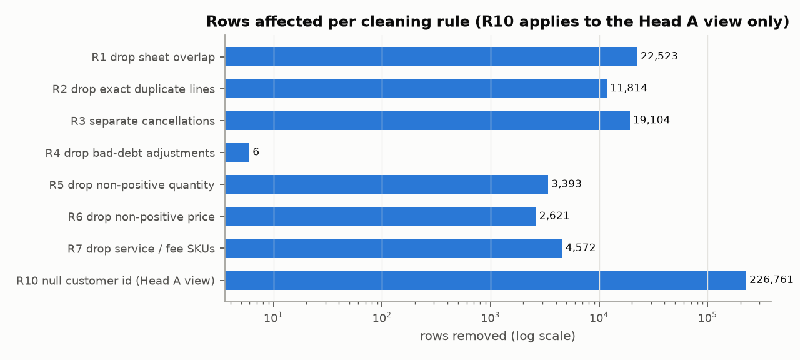
*Figure 1 — Rows removed per rule (log scale).*

Bronze → silver: 1,067,371 → 1,003,338 lines (64,033 removed,
6.0%); 53,628 → 39,516 invoices; 5,305 →
4,724 SKUs; distinct descriptions 5,335 → 4,684
(58,116 lines relabelled). 1,642 lines are flagged as outliers (quantity >
520 or line revenue > 734.40, thresholds estimated on pre-validation data only) and
capped rather than dropped. The Head A view keeps 776,577 lines with a customer id; the
226,761 guest lines stay in Head B. The largest single effect is **R1, the overlap between
the two yearly sheets** (22,523 lines) — the original `scripts/etl.py` concatenated the
sheets and would have double-counted every order of 1–9 December 2010.

**A bug found in my own earlier work.** The first version of R2 used the description as part of
the duplicate key. The data-quality suite (`check_silver`) then failed on the real data: two lines
with the same invoice, SKU, quantity, time and price but spellings "BUNTING , SPOTTY" / "SPOTTY
BUNTING" survived R2 and became exact duplicates after R8 canonicalised the spelling. The key now
excludes the description (the SKU identifies the product), a unit test covers it, and the pipeline
was re-run end to end. The effect was two lines; the lesson is that a quality gate on the *output*
catches ordering bugs that rule-by-rule reasoning misses.

## 3. Leakage investigation

What I tested for, how, and what I found (all on the **validation** snapshot; untuned XGBoost so the
effect is the data, not tuning — `make leakage`, `reports/metrics/leakage.json`):

| Test | Without the leak | With the leak | Finding |
|---|---|---|---|
| **Label-window leak**: features computed through T + 90 d | PR-AUC **0.8070** (ROC 0.7824) | PR-AUC **1.0000** (ROC 1.0000) | A perfect score: recency < 90 days *is* the label. Exactly the Appendix B warning. |
| **Split leak**: row-level KFold (same customer on both sides; 89% of validation rows) vs. customer-grouped folds | 0.7760 grouped | 0.7774 row-level | Negligible here: snapshots of one customer are different feature vectors. Grouping kept as the safe default. |
| **Temporal optimism**: CV on train vs. true forward validation | CV 0.7760 | forward 0.8070 | Forward score is *higher* — the June snapshot is easier. Not leakage but **distribution shift**, which is why calibration/threshold use a separate snapshot. |
| **Cancellation netting** (a common cleaning step) | separated, point-in-time | see table below | Netting would delete pre-cutoff purchases because of post-cutoff cancellations. Avoided by design (R3). |

| Cutoff | Pre-cutoff lines netting would touch | Customers affected |
| --- | ---: | ---: |
| 2010-06-01 | 2,018 | 315 |
| 2010-09-01 | 1,966 | 344 |
| 2010-12-01 | 2,379 | 323 |
| 2011-03-01 | 1,624 | 300 |
| 2011-06-01 | 1,613 | 292 |
| 2011-09-01 | 2,298 | 285 |

*Table 2 — Pre-cutoff lines whose (customer, SKU) is cancelled inside the following label window:
the lines a netting step would alter using future information.*

**Tests that would catch a regression** (`tests/test_features.py`, run in CI on synthetic data):
adding purchases after the cutoff must leave every feature unchanged; the label is 1 only for an
order inside [T, T+90 d); cancellations after T are ignored; the deliberately leaky variant must
differ from the clean one; `check_gold` rejects negative recency or recency beyond the observation
window (a feature row that saw the future) and any evaluation-only column used as a feature. The
reported model has no leak detected by these tests; the evidence that they *would* detect one is the
1.0000 result above.

## 4. Spot-check (identical folds and preprocessing)

12,277 training snapshots, 5-fold customer-grouped CV, same
`ColumnTransformer` for all models, untuned defaults, fit time per fold on 16 cores.

| Model | PR-AUC (mean ± sd) | ROC-AUC | Brier | Recall@top10% | Fit s |
| --- | ---: | ---: | ---: | ---: | ---: |
| Extra trees | 0.7772 ± 0.0116 | 0.779 | 0.190 | 0.197 | 0.48 |
| XGBoost | 0.7760 ± 0.0129 | 0.778 | 0.190 | 0.195 | 0.55 |
| Logistic regression | 0.7754 ± 0.0111 | 0.780 | 0.189 | 0.195 | 0.10 |
| Random forest | 0.7745 ± 0.0149 | 0.774 | 0.191 | 0.195 | 1.00 |
| MLP (64-32) | 0.7731 ± 0.0137 | 0.775 | 0.191 | 0.195 | 0.50 |
| HistGradientBoosting | 0.7701 ± 0.0124 | 0.771 | 0.193 | 0.193 | 0.31 |
| LightGBM | 0.7695 ± 0.0131 | 0.771 | 0.194 | 0.194 | 0.37 |
| k-NN (k=50) | 0.7581 ± 0.0136 | 0.754 | 0.198 | 0.194 | 0.05 |
| Gaussian naive Bayes | 0.7438 ± 0.0151 | 0.745 | 0.287 | 0.191 | 0.06 |
| Decision tree | 0.7388 ± 0.0157 | 0.755 | 0.200 | 0.189 | 0.16 |
| Heuristic: recency deciles | 0.5823 ± 0.0181 | 0.641 | 0.235 | 0.140 | 0.00 |
| Baseline: rule 'ordered in last 60 days' | 0.5383 ± 0.0181 | 0.608 | 0.238 | 0.139 | 0.00 |
| Baseline: Dummy (prior) | 0.4731 ± 0.0072 | 0.500 | 0.249 | 0.123 | 0.00 |

*Table 3 — Spot-check. Baselines and heuristic are scored with the same metrics.*

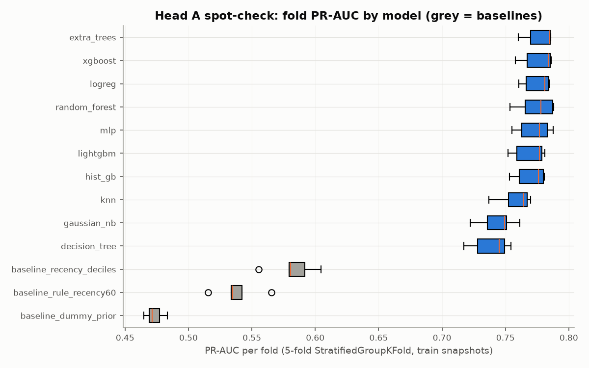
*Figure 2 — Fold PR-AUC; grey = baselines.*

Carried forward: **Extra trees and XGBoost** (see D2 §9 for the verdict). Note the honest result that logistic
regression (0.7754) is within noise of both.

## 5. Hyper-parameter tuning

**Search spaces** (`retention/tune.py::suggest`): *Extra trees* — `n_estimators` 100–800 (step 50),
`max_depth` 4–32, `min_samples_leaf` 1–60 (log), `max_features` 0.2–1.0, `criterion` {gini,
entropy}. *XGBoost* — `n_estimators` 100–1000, `learning_rate` 0.005–0.3 (log), `max_depth` 2–10,
`min_child_weight` 1–50 (log), `subsample` 0.5–1, `colsample_bytree` 0.4–1, `reg_lambda` and
`reg_alpha` 0.001–10 (log), `gamma` 0–5. Ranges bracket the library defaults by roughly an order of
magnitude on each side; log scales where the effect is multiplicative. **Method:** Optuna TPE
(seed 42), 40 trials per model, `MedianPruner` fed with the running mean
PR-AUC after each fold (pruning after fold 2, from trial 9); every trial is a nested MLflow run.

| Model | Trials | Complete | Pruned | Default CV PR-AUC | Best CV PR-AUC | Gain | Top-3 hyper-parameter importances |
| --- | ---: | ---: | ---: | ---: | ---: | ---: | --- |
| Extra trees | 40 | 39 | 1 | 0.7772 | 0.7779 | +0.0007 | min_samples_leaf (0.69), max_depth (0.19), max_features (0.05) |
| XGBoost | 40 | 40 | 0 | 0.7760 | 0.7809 | +0.0048 | learning_rate (0.75), max_depth (0.08), reg_alpha (0.07) |

*Table 4 — Tuning results on the same five folds as the spot-check. Local wall-clock: extra trees
2.2 min, XGBoost 1.6 min.*

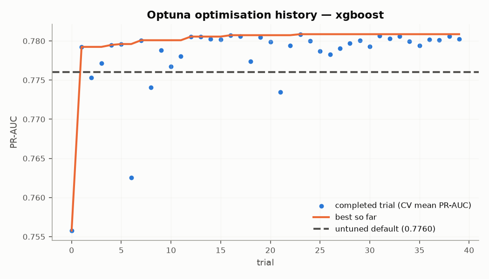{: style="width:49%;display:inline-block"}
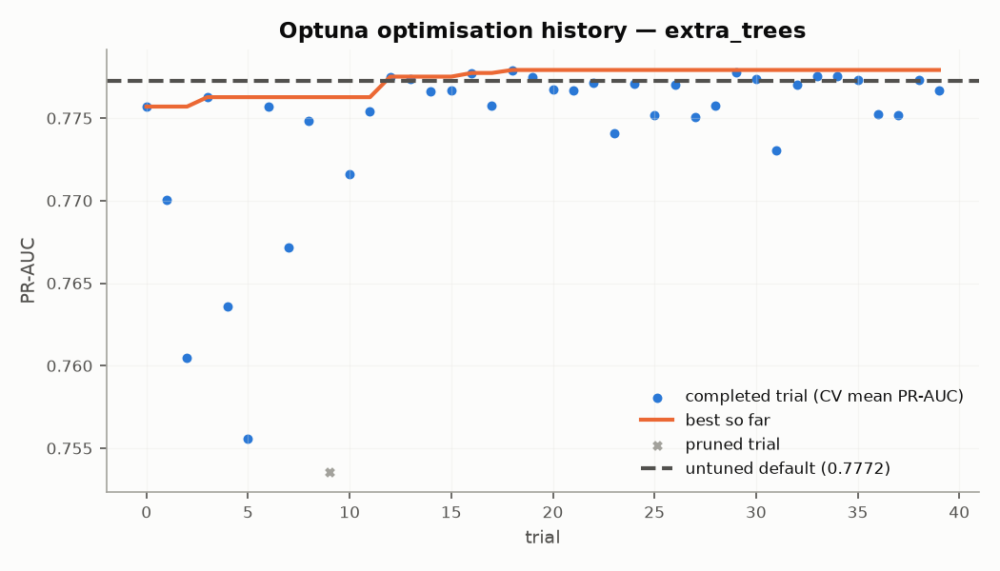{: style="width:49%;display:inline-block"}
*Figure 3 — Optimisation histories (dashed = untuned default).*

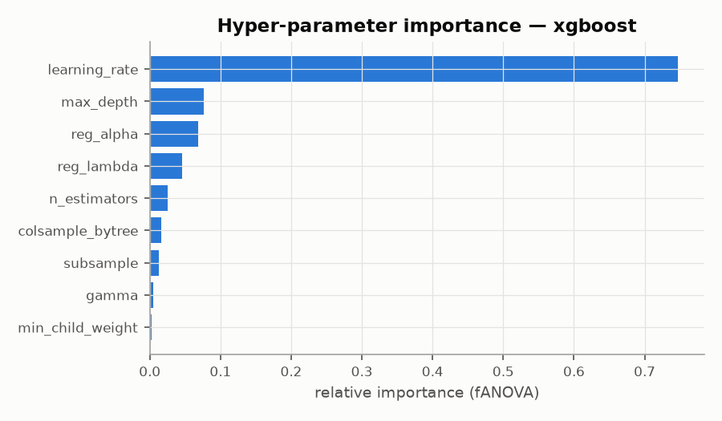{: style="width:49%;display:inline-block"}
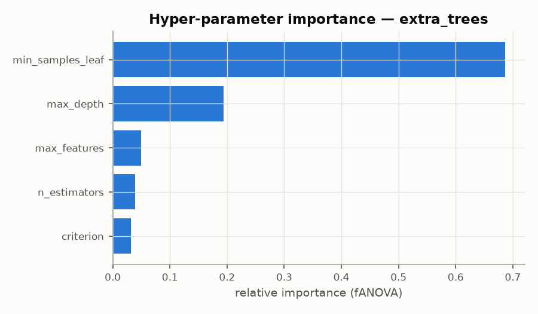{: style="width:49%;display:inline-block"}
*Figure 4 — Hyper-parameter importances (fANOVA).*

**Interpretation.** Tuning improved PR-AUC by only +0.0048 (XGBoost) and
+0.0007 (extra trees) — less than one fold standard deviation. Only
1 of 80 trials were pruned, because the spread between
configurations is smaller than fold-to-fold noise, so few trials fall clearly below the median early.
Both facts say the same thing: **this problem is limited by the information in the features, not by
hyper-parameters**; further tuning budget would be better spent on features (D5 ablation). Winner:
**XGBoost** with `n_estimators`=800, `learning_rate`=0.007433, `max_depth`=4, `min_child_weight`=1.679, `subsample`=0.534, `colsample_bytree`=0.6824, `reg_lambda`=1.704, `reg_alpha`=0.5502, `gamma`=3.833.

## 6. Calibration

The tuned model is refit on all training snapshots and scored on the validation snapshot
(2011-06-01). Three options are compared by 5-fold **out-of-fold** calibration on that snapshot
(the calibrator never scores rows it was fitted on):

| Method (5-fold out-of-fold on validation) | Brier | Log-loss | ECE |
| --- | ---: | ---: | ---: |
| none | 0.1885 | 0.5542 | 0.050 |
| sigmoid | 0.1861 | 0.5476 | 0.010 |
| isotonic | 0.1871 | 0.5566 | 0.016 |

*Table 5 — Calibration comparison (validation snapshot).*

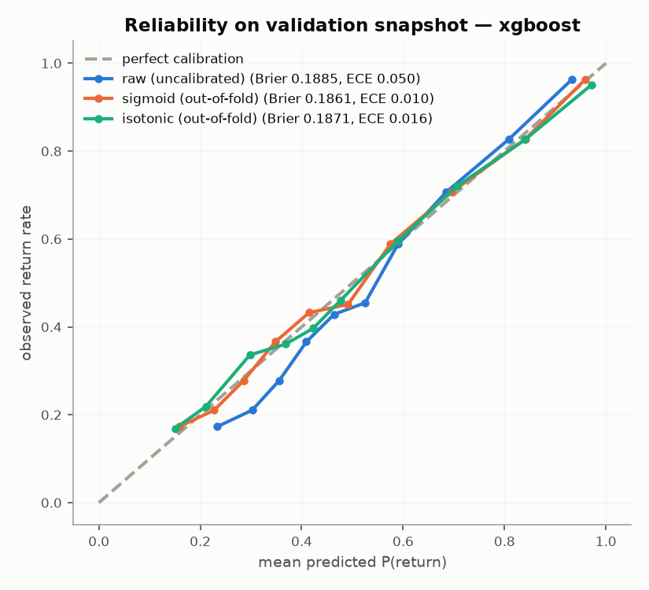{: style="width:49%;display:inline-block"}
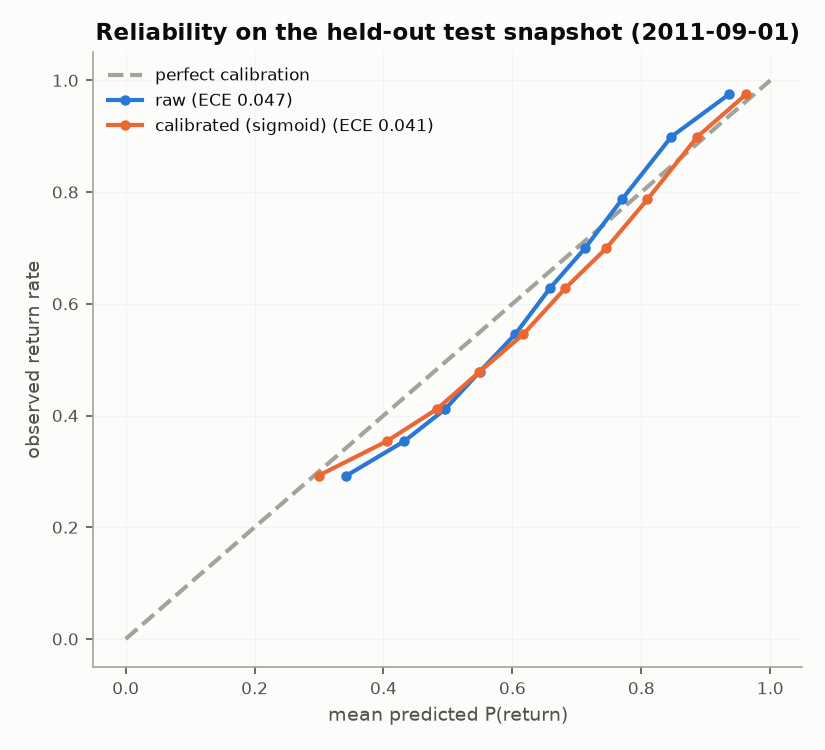{: style="width:49%;display:inline-block"}
*Figure 5 — Reliability before/after on validation (left, out-of-fold) and on the test snapshot
(right, reported once).*

**Chosen: sigmoid** (Platt scaling on the logit). It has the lowest Brier
(0.1885 → 0.1861) and cuts ECE from 0.050 to 0.010. Isotonic is
close but has more variance with ~2.7k rows and produces a step function (ties at the threshold);
sigmoid is monotone, smooth and has two parameters. Calibration matters here even though ranking is
unchanged, because the probability is multiplied by customer-specific dollar values (§7).

## 7. Threshold selection — expected profit

**Action:** send the 15% coupon to customers whose calibrated P(return) is **at or below** the
threshold (the at-risk ones). Cost assumptions (`params.yaml → business`; the value horizon was revised once, see the
negative result below): coupon handling $4.00; discount 15% of the customer's average
order value, lost on every redeemed coupon; a coupon brings back a true lapser with probability
0.20; a saved customer resumes their recent spend for 365 days at a
30% gross margin. Per contacted customer: lapser → `save_rate × (value − discount) −
coupon`; would-return-anyway → `−(coupon + discount)`. Not contacting = 0.

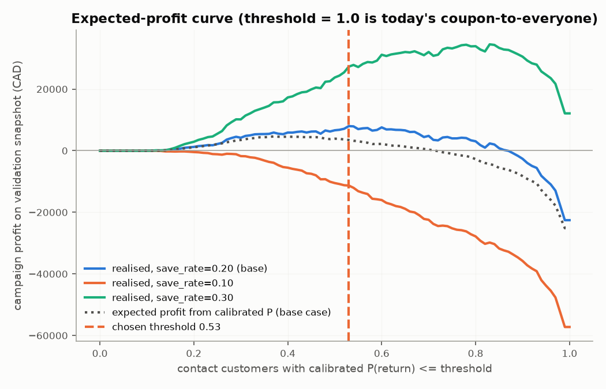
*Figure 6 — Realised campaign profit on the validation snapshot versus threshold for three save
rates; threshold 1.0 = today's coupon-to-everyone.*

**Chosen threshold: P(return) ≤ 0.53** (selected on out-of-fold calibrated probabilities
of the validation snapshot). On that quarter it contacts 1,599 of 2,658
customers (60.2%), reaches 1,088 of 1,330 lapsers and
earns $7,979, versus −$22,565 for coupon-to-everyone — **$30,544 better**.
Business consequence: the current blanket coupon loses money, mostly by discounting loyal
high-spenders who would order anyway; the model's first value is **not sending** 40% of coupons.

| Assumption | Profit-maximising threshold | Max validation profit |
| --- | ---: | ---: |
| save rate = 0.10 | 0.00 | $0 |
| save rate = 0.20 | 0.53 | $7,979 |
| save rate = 0.30 | 0.83 | $34,530 |
| save rate 0.20, value horizon 90 d (first design) | 0.00 | $0 |

*Table 6 — Sensitivity. At a 10% save rate no threshold is profitable; the decision is fragile to
this assumption and a randomised pilot (hold-out group) is the recommended next step.*

**Negative result (first design).** I first valued a saved customer at one label window (90 days)
of margin. Under that assumption every threshold loses money and the optimum is "contact nobody"
(coupon-to-everyone would lose −$84,779 per quarter): for a one-order customer the 15%
discount is as large as the 90-day margin. The assumption was economically wrong — saving a lapser
restores a relationship, not one order — and was replaced by a stated 365-day horizon. Both versions
are kept in `train_final.json`.

**Per-customer expected-value policy.** Because probabilities are calibrated, each customer can be
contacted only if their own expected profit is positive. On validation this contacts
1,185 customers and earns $13,420 — more than the single global
threshold. It is reported as the recommended D5 refinement; the graded operating point remains the
single threshold.

## 8. Final held-out test results (reported once)

Test snapshot 2011-09-01: 2,768 customers, base rate 60.7% (autumn peak —
higher than any training snapshot except Sep 2010). The test set has been evaluated
**2 times**: look 1 before the §2 duplicate fix (PR-AUC 0.8504), look 2
after the full re-run with no modelling decision in between (identical PR-AUC). No choice in this
report was made on test data.

|  | PR-AUC | 95% CI (bootstrap) | ROC-AUC | Brier | Recall@top10% |
| --- | ---: | ---: | ---: | ---: | ---: |
| Model (XGBoost, calibrated) | 0.8504 | 0.835–0.865 | 0.7718 | 0.1885 | 0.161 |
| Baseline: Dummy (prior) | 0.6069 | 0.586–0.625 | 0.5000 | 0.2565 | 0.126 |
| Baseline: rule 'ordered in last 60 days' | 0.6734 | 0.649–0.695 | 0.6187 | 0.2439 | 0.151 |
| Heuristic: recency deciles | 0.7123 | 0.687–0.734 | 0.6563 | 0.2416 | 0.132 |

*Table 7 — Test metrics with 95% bootstrap intervals (1,000 resamples for the model, 300 for
baselines). Baselines fitted on the training snapshots.*

The model beats the best heuristic by **+0.1381 PR-AUC**, with non-overlapping
intervals; ECE on test is 0.023, so calibration transfers across the seasonal shift.
PR-AUC is inflated by the 60.7% base rate; PR-AUC of the lapse class is 0.6462.
**Campaign on the test quarter:** the validation threshold contacts 1,139 customers
(708 of 1,088 lapsers) and roughly breaks even (−$7),
versus −$55,176 for coupon-to-everyone: **$55,169 better than the status quo**
(≈ $220,676 a year over four campaigns, under the stated assumptions). It does **not** beat
"contact nobody": with a higher base rate, fewer customers are profitable to contact than on
validation. The expected-value policy stays positive ($2,421, 376
contacts) because it adapts to each customer's probability — further evidence for the D5 refinement.

## 9. Error analysis

| Segment | n | Return rate | PR-AUC | Lapser recall | Selection rate | Recall gap vs overall |
| --- | ---: | ---: | ---: | ---: | ---: | ---: |
| region: ON | 228 | 69.3% | 0.861 | 0.500 | 32.5% | -15.1 pts |
| region: QC | 2,500 | 60.2% | 0.850 | 0.662 | 41.9% | +1.2 pts |
| tenure band: 6-12 months | 445 | 62.5% | 0.851 | 0.629 | 41.8% | -2.2 pts |
| tenure band: <6 months | 686 | 46.4% | 0.704 | 0.810 | 66.5% | +15.9 pts |
| tenure band: >12 months | 1,637 | 66.2% | 0.882 | 0.552 | 30.4% | -9.9 pts |
| spend quartile: Q1 (low) | 763 | 40.6% | 0.544 | 0.883 | 83.2% | +23.2 pts |
| spend quartile: Q2 | 702 | 53.1% | 0.683 | 0.669 | 52.7% | +1.8 pts |
| spend quartile: Q3 | 650 | 66.8% | 0.841 | 0.333 | 16.8% | -31.7 pts |
| spend quartile: Q4 (high) | 653 | 86.2% | 0.965 | 0.178 | 3.8% | -47.3 pts |
| frequency band: 1 order | 1,280 | 44.0% | 0.610 | 0.840 | 75.9% | +18.9 pts |
| frequency band: 2-3 orders | 897 | 65.8% | 0.811 | 0.332 | 17.9% | -31.8 pts |
| frequency band: 4+ orders | 591 | 89.2% | 0.971 | 0.062 | 1.2% | -58.8 pts |

*Table 8 — Test performance by segment (n ≥ 50; spend quartiles from training data). "Lapser
recall" = share of the segment's lapsers who would receive the coupon.*

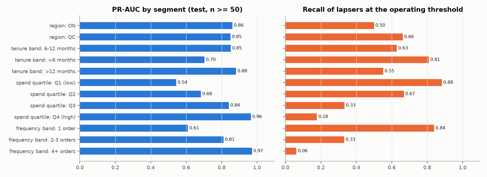
*Figure 7 — PR-AUC and lapser recall by segment.*

**Where the model fails.** Ranking quality collapses for **one-order customers** (PR-AUC
0.610, n = 1,280) and the **lowest spend quartile** (0.544): with one
purchase there is no cadence, trend or habit to learn from, and these customers are close to coin
flips. It is excellent for frequent buyers (0.971). **Where the decision fails.** Lapser
recall is 0.883 in the lowest-spend quartile but only 0.178 in the
highest: a single probability threshold rarely flags high spenders, yet a lapsing high spender is
the most valuable customer to save. **Implications:** (1) do not market "we know who will churn" for
new customers — treat them with a separate onboarding rule; (2) move to the per-customer
expected-value policy, which weighs value, not just probability; (3) the spend-quartile recall gap
is a fairness finding (> 5 points) that the D5 audit must address with mitigations.

## 10. Head B — association rules

**Baskets.** 32,126 invoices before 2011-09-01 × 4,466 items, density
0.54%: dense boolean **136.8 MB** vs. sparse CSR **3.8 MB**
(35.5× smaller). Items below minimum support are pruned before mining (lossless by the
Apriori property). The most frequent item, 85123A WHITE HANGING HEART T-LIGHT HOLDER, appears in 14.9% of
baskets — no "plastic bag" item appears in nearly every basket, so no item had to be removed for that
reason (service codes such as POSTAGE were removed by R7).

**Apriori vs. FP-Growth** at the chosen parameters on the same pruned input: Apriori
**2.1 s**, FP-Growth **241.4 s**, identical 7,219 itemsets (asserted in
code). An honest surprise: in mlxtend, FP-Growth is 116× *slower* here — Apriori is
vectorised in NumPy while FP-Growth recurses in pure Python, and with `max_len=3` Apriori's candidate
explosion never happens. FP-Growth is kept in production as required (offline, weekly, a few
minutes is acceptable); at lower support or longer patterns its asymptotic advantage returns.

**Sweep** (mined on invoices before 2011-07-01, scored on the 2011-07-01…08-31 slice,
2,579 leave-one-out cases; the holdout is not used):

| min_support | Itemsets | Rules | Apriori s | Hit@5 rules-only | Hit@5 hybrid | Hit@5 popularity | Basket coverage |
| --- | ---: | ---: | ---: | ---: | ---: | ---: | ---: |
| 0.003 | 30,257 | 37,765 | 5.46 | 0.184 | 0.186 | 0.028 | 94.9% |
| 0.004 | 13,138 | 14,369 | 2.79 | 0.172 | 0.174 | 0.028 | 93.1% |
| 0.005 | 7,179 | 7,327 | 2.03 | 0.160 | 0.162 | 0.028 | 91.5% |
| 0.0075 | 2,562 | 2,273 | 0.77 | 0.138 | 0.142 | 0.028 | 87.7% |
| 0.01 | 1,363 | 1,003 | 0.42 | 0.121 | 0.127 | 0.028 | 82.6% |
| 0.015 | 582 | 266 | 0.18 | 0.078 | 0.089 | 0.028 | 66.7% |
| 0.02 | 340 | 101 | 0.10 | 0.054 | 0.067 | 0.028 | 55.9% |

*Table 9 — Support sweep at confidence 0.2, lift ≥ 3.*

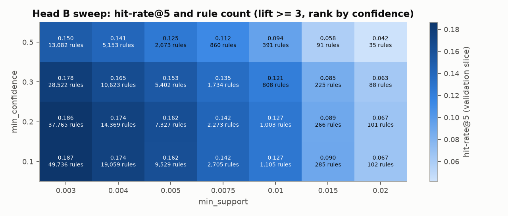
*Figure 8 — Hit-rate@5 and rule count over support × confidence.*

| min_lift | Rank by | Rules | Hit@5 hybrid |
| --- | ---: | ---: | ---: |
| 1 | confidence | 8,166 | 0.161 |
| 1.5 | confidence | 8,146 | 0.161 |
| 2 | confidence | 7,939 | 0.162 |
| 3 | confidence | 7,327 | 0.162 |
| 1 | lift | 8,166 | 0.146 |
| 1.5 | lift | 8,146 | 0.146 |
| 2 | lift | 7,939 | 0.146 |
| 3 | lift | 7,327 | 0.146 |

*Table 10 — Lift floor and ranking at support 0.005.*

**Chosen:** support **0.005** (every itemset backed by ≥ 161
invoices), confidence **0.2**, lift ≥ **3**, final list ranked by
**confidence** after deduplicating each consequent by its highest-lift rule. Hit-rate keeps rising
as support falls (≈ +0.012 per step) while rules grow 2–2.6× and mining time ~3× per step; 0.005 is
the point where rules stay in the thousands and each rule has statistical support. Confidence 0.1
vs. 0.2 is a tie; ranking by confidence is slightly better than by lift. Result:
**7,512 rules** (8,338 before the lift filter; median lift 7.9).

**The lift trap, from our data.** *22294 HEART FILIGREE DOVE SMALL → 85123A WHITE HANGING HEART T-LIGHT HOLDER*: confidence
**44.7%**, support 1.07%, but lift **2.998** — discarded by the
lift ≥ 3 floor. The consequent is the store's best-seller, in 14.9% of
all baskets, so a 44.7% rule only says "people who buy anything buy the best-seller"; the popularity
fallback already recommends it. Keeping such rules would crowd out genuinely associated items.

**Offline evaluation on the temporal holdout** (invoices from 2011-09-01, 6,897 baskets,
one hidden item each):

| Strategy | Hit-rate@5 | Basket coverage | Catalogue coverage |
|---|---:|---:|---:|
| Rules only | 0.143 | 91.7% | — |
| Rules + popularity fill (served) | **0.145** | 91.7% | 10.1% (452 items) |
| Global popularity baseline | 0.017 | 100% | 5 items |

*Table 11 — Rules beat popularity 8.6× (Appendix B "excellent": ≥ 2.5× with coverage >
40%).* Popularity is weak because baskets are large and the best-sellers are usually already in them.

**Serving behaviour** (tested in `tests/test_engine.py` and `tests/test_api.py`): rules are indexed
by antecedent item; a rule fires only if its whole antecedent is in the basket and its consequent is
not; each recommendation returns its firing rule. Empty basket → `strategy: "empty_basket"`
(best-sellers); no rule matches → `"popularity_fallback"` with `unknown_items` listed; fewer than k
rule hits → `"rules+popularity"`. Example: basket [22916, 22918] → 22917 HERB MARKER ROSEMARY (rule, lift 147); 22920 HERB MARKER BASIL (rule, lift 140); 22919 HERB MARKER MINT (rule, lift 140).

## 11. Cloud training (SageMaker) and cost

**Done and verified locally:** `boreal_marche.retention.sm_train` follows the script-mode contract
(hyper-parameters as CLI arguments, data from `SM_CHANNEL_TRAIN`, model to `SM_MODEL_DIR`, objective
printed as `cv_pr_auc=…`); run locally it prints `cv_pr_auc=0.776837` (the spot-check's XGBoost
default is 0.7768 — same code path). `python -m boreal_marche.cloud --provider aws` builds a self-contained source
directory (verified by running it with `python -I`, no project path) and defines a **Bayesian** HPO
job: 20 jobs, 2 in parallel, `ml.m5.large`, **managed spot**, `max_run` 15 min, `max_wait` 30 min,
region `ca-central-1`. The same entry point also runs as an **Azure ML sweep** (Bayesian sampling,
low-priority `Standard_DS3_v2`, `canadacentral`) or locally — one switch,
`python -m boreal_marche.cloud --provider local|aws|azure`; SageMaker remains the graded option.

> **Control point — managed training evidence.** The managed HPO job with its console evidence,
> the real-time endpoint (deploy → invoke → delete) and the billed cost are not yet recorded in this
> report; they must be verified and the table below completed before submission (runbook:
> `docs/runbooks/SAGEMAKER_HPO.md`). Cloud cost incurred to date: **$0**.

| | Local Optuna (16-core laptop) | SageMaker HPO |
|---|---|---|
| Trials | 40 (XGBoost) | 20 (planned) |
| Best CV PR-AUC | 0.7809 | to be verified |
| Wall-clock | 1.6 min | to be verified (expect ≥ 20 min: ~3 min container start per job) |
| Cost | $0 | to be verified (estimate < $0.50 on spot) |

**Crossover.** One trial costs ~2 s locally (5 folds × 12k rows). Managed training only wins when a
trial takes longer than the ~3-minute container start-up many times over, needs more memory than a
laptop (tens of GB), must run unattended on a schedule, or the data may not leave the cloud
account. At ~100× the data (≈ 1M snapshots) or deep models, trials would take tens of minutes and
parallel managed jobs would pay off. For this project, local tuning is the right tool; SageMaker is
exercised to demonstrate the workflow and its cost discipline.

## 12. MLflow evidence and promotion policy

Tracking: SQLite backend (`mlflow.db`), artifacts in `mlruns/`, every run tagged with git commit,
raw-data SHA-256 and gold-table SHA-256. **278 runs** in
`boreal-retention` (spot-check parent and per-family runs, 80 tuning trials with
their parents, final fits) and **2** in `boreal-recommend`. Registry
`boreal-retention`: 4 versions — **XGBoost** as `champion`
(validation PR-AUC 0.8091), **Extra trees** as `challenger` (0.8038).
View: `make mlflow-ui` → compare runs `final_xgboost` / `final_extra_trees`.

| Gate | Result |
| --- | --- |
| beats best baseline by 0.05 pr auc | pass |
| calibrated brier not worse than raw | pass |
| ece at most 0.05 | pass |
| beats current champion by 0.005 | FAIL |

*Table 12 — Promotion gates for the champion (policy: `docs/MLFLOW_PROMOTION_POLICY.md`).* The best
validation baseline is 0.6167. The API resolves `models:/boreal-retention@champion`
at startup and falls back to `artifacts/model.joblib` if the registry is unreachable, so a rollback is
an alias move plus restart, not a redeploy.

## 13. Model artifact and metadata sidecar

`artifacts/model.joblib` (315 KB) holds **one** `RetentionModel` object: the fitted
scikit-learn `Pipeline` (imputation with indicators → signed log → scaling → one-hot → XGBoost), the
calibrator, the feature order and the threshold. `artifacts/model_meta.json` records model version
`0.3.0+xgboost`, training time, 12,277 training rows, train and calibration cut-offs,
feature names in order, hyper-parameters, calibration method, threshold and decision rule, validation
and test metrics, library versions (Python 3.11.16, scikit-learn 1.7.2, XGBoost
3.2.0, …), git commit `a803635a9530…-dirty`, MLflow run `8b2c7d272eef…`, raw-data SHA-256
and the promotion decision. A golden-prediction test replays eight fixed customers through `/predict`
and must match to 1e-6.

**Why preprocessing lives inside the artifact.** If the API re-implemented imputation or encoding,
any difference (a new median, a category order) would silently change predictions — training/serving
skew. With one object, the API only builds a DataFrame in the recorded feature order.

**joblib vs. pickle.** joblib *is* pickle, with efficient storage of large NumPy arrays and
compression; neither is safe to load from an untrusted source — unpickling can execute arbitrary
code (a crafted `__reduce__`), so artifacts are loaded only from our own registry or repository
(checksummed in the sidecar) and never from user uploads. Both are **version-brittle**: an object
pickled with scikit-learn 1.7.2 may fail or behave differently under another version,
which is why library versions are pinned in `pyproject.toml`, recorded in the sidecar, and the
Docker image installs the same ranges. Portable formats (ONNX, XGBoost JSON) would reduce brittleness
but cannot carry the full custom pipeline and calibrator without extra work — a D5 option.

## 14. Limitations

Propensity, not uplift — the profit numbers rest on an assumed save rate and are fragile to it
(Table 6); a randomised hold-out is needed before trusting dollars. The test quarter has a higher
base rate than all but one training snapshot; one test snapshot gives one season's view. Re-skinned
regions are synthetic, so regional subgroup results describe the mapping. The catalogue is giftware
bought largely by businesses. SageMaker evidence requires verification (control point, §11). Head C is not implemented yet
(Weeks 9–10). The Docker image is 2.2 GB before optimisation (D4 target < 1 GB).

## 15. Sources, AI-tool use and corrections

Chen (2012) UCI Online Retail II, CC BY 4.0; scikit-learn, XGBoost, LightGBM, Optuna, MLflow,
mlxtend documentation. AI-assisted coding and drafting tools were used for code, tests and this
text; I reviewed each module and can explain every line. **Where AI-generated output had to be
corrected:** the profit model's 90-day value horizon (degenerate "contact nobody", §7); the duplicate
key including descriptions (§2); a missing search space for three model families, caught by the
end-to-end smoke test; `mean_gap_days` computed between invoices rather than order days (zero gaps
made `overdue_ratio` explode to 253,881 — now median 0.65); an MLflow/SQLAlchemy 2.1 incompatibility
(pinned `< 2.1`); and `dvc init` staging files in Git, which I reverted so that commits stay a human
decision.
