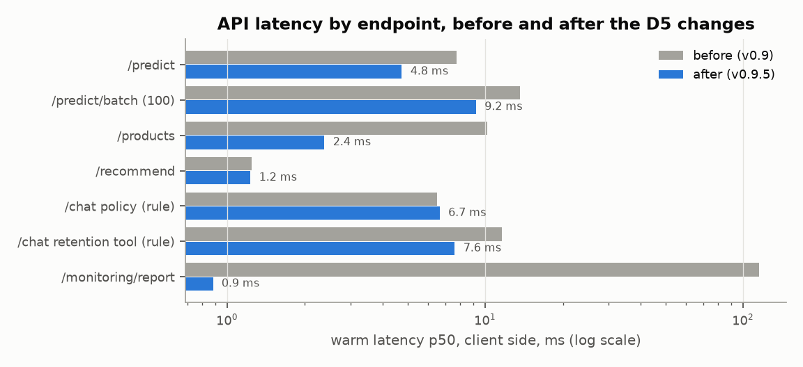
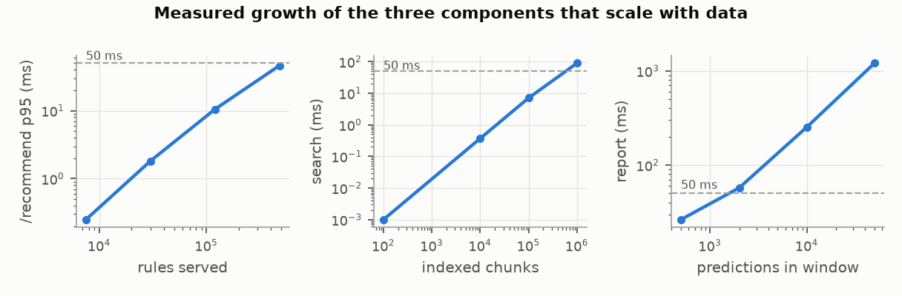
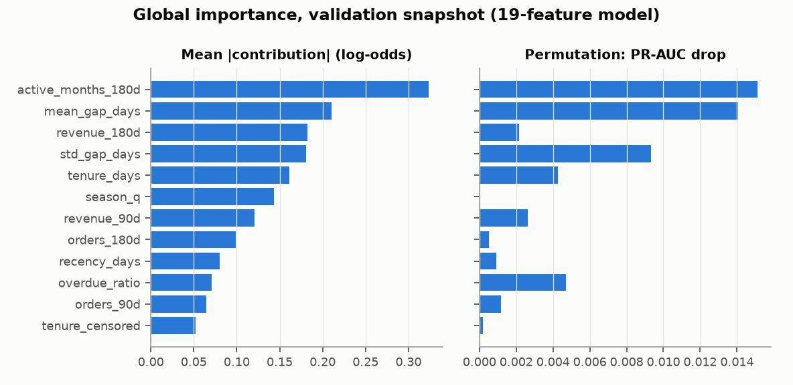
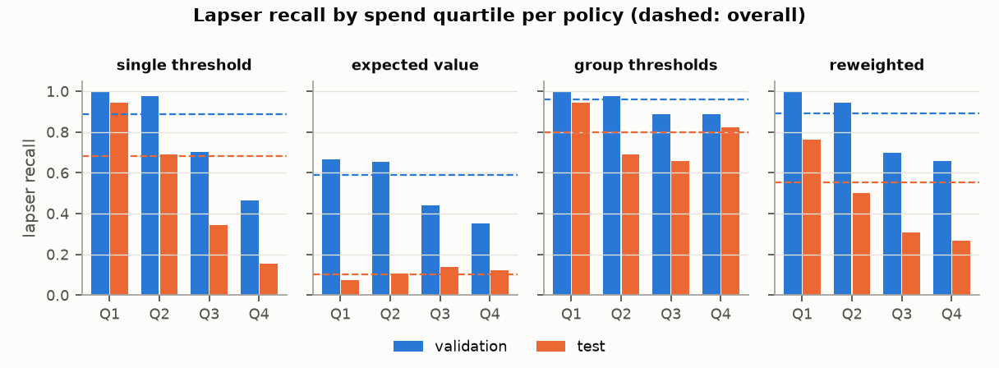

# D5 — Optimization and Ethics Report
**Boréal Marché Customer Intelligence Platform** · Capstone Project 1

Olga Morgunova (individual project) · 420-977-VA AI Development Project · Instructor: Steve Ataky, Ph.D. · Vanier College, LEA.EU · Repository tag `v0.9.5` · KLO 5

## 1. Summary

Every number below is generated from an evidence file in `reports/metrics/` by
`python -m boreal_marche.reporting.build D5`; the scripts that produced them are named in each
section. What changed in the system for this deliverable:

| Area | Change | Evidence |
|---|---|---|
| Performance | column-wise model input, folded catalogue, cached monitoring report, warm-up before `/ready`, startup timings in `/ready` | §2, `latency_profile.json` |
| Interpretability | exact per-prediction factors, `POST /predict?explain=N`, shown in the interface | §5, `interpretability.json` |
| Data minimisation | **the model now uses 19 of 37 features**; the other 18 are no longer stored | §6, `minimisation.json` |
| Fairness | subgroup audit, four policies compared, a recommendation with its cost | §7, `fairness.json` |
| Governance | register, notice, retention and deletion schedule finalised; promotion gate gains a minimisation clause | §8, `GOVERNANCE_LOI25.md` |

Model `0.9.5+xgboost` replaces `0.3.0+xgboost`: test PR-AUC 0.847 [0.832, 0.863]
against 0.850, scored once after every choice was fixed (test look 3, §6).

## 2. Performance optimisation

**Method.** `scripts/latency_profile.py` starts the real server (`uvicorn`, one worker, as in the
container), measures spawn → `/ready` = 200 three times (cold start), the first call to each
endpoint after start-up, then 200 sequential warm calls per endpoint over one keep-alive
connection; the API's own middleware timer (`request_log`) gives the server-side share. "Before" is
the unchanged v0.9 commit run from a clean `git worktree`; "after" is this tag. Machine:
win32, Python 3.11.16, 16 logical CPUs. I profiled the slow handlers with `cProfile` and per-stage timers before changing
anything.

| Endpoint | First call before / after | Warm p50 / p95 before | Warm p50 / p95 after | Server p50 | p50 change |
|---|---|---|---|---|---|
| `/predict` | 17.8 / 9.3 | 7.8 / 9.9 | 4.8 / 7.6 | 6.9 → 3.9 | 39% |
| `/predict/batch (100)` | 18.8 / 12.5 | 13.7 / 16.0 | 9.2 / 11.4 | 11.2 → 7.5 | 33% |
| `/products` | 11.2 / 4.3 | 10.2 / 12.6 | 2.4 / 3.1 | 9.4 → 1.8 | 77% |
| `/recommend` | 4.5 / 3.6 | 1.2 / 1.7 | 1.2 / 1.6 | 0.7 → 0.7 | 1% |
| `/chat policy (rule)` | 11.6 / 9.0 | 6.5 / 7.9 | 6.7 / 7.4 | — | -2% |
| `/chat retention tool (rule)` | 16.9 / 13.4 | 11.6 / 15.4 | 7.6 / 10.9 | — | 34% |
| `/monitoring/report` | 51.1 / 53.0 | 115 / 121 | 0.9 / 1.1 | 114 → 0.3 | 99% |

*Table 1 — Latency by endpoint, ms (client side unless "server"). `/chat` server time includes the
assistant's internal HTTP call to `/predict`, so only client time is compared.*

*Figure 1 — Warm p50 by endpoint before and after.*

**What I measured, what I changed, what it did.**

1. **`/predict` (7.8 → 4.8 ms p50).** Of ~7 ms server time, the
   XGBoost call was 0.3 ms; building a one-row pandas frame from a dict and casting it took 2.2 ms
   and the sklearn preprocessing 1.8 ms. The frame is now built column by column with NumPy (0.3 ms);
   a test asserts the frame and the predictions are identical to the old path. Measured with the old
   model first (4.5 ms), so the gain is the code, not the smaller model.
2. **`/products` (10.2 → 2.4 ms).** Each search re-normalised the
   accents of all 4,724 descriptions. They are folded once at start-up.
3. **`/monitoring/report` (115 → 0.9 ms).** The report was recomputed
   on every request while the dashboard polls it. A report younger than 10 s is served
   as is (`?fresh=true` recomputes; the alert loop is unchanged), and the KS test uses the
   asymptotic p-value — the exact method was the largest single cost and only the statistic is
   thresholded.
4. **Cold path.** One warm-up call per head now runs before `/ready` turns 200, so XGBoost, ONNX
   Runtime and pandas initialise before the first customer: first `/predict` 17.8
   → 9.3 ms.

**Cold start versus warm, and loading models at start-up.** Cold start (spawn → ready) is
5.7 s locally and 5.7 s → 5.8 s for the container
(`docker run` → ready, image already pulled) — **unchanged, and I report that rather than hide it**.
Inside the container the model loads in 166 ms and the embedding model in
1.8 s; the rest is Python importing scikit-learn, SciPy, pandas and FastAPI (~2 s)
and container start. I loaded the two slow artifacts in parallel: it saves ~0.45 s when the model
comes from the MLflow registry (I/O-bound) and nothing measurable from the file, so the gain is
real only in the registry deployment. Loading **per request** instead of at start-up would cost,
measured in a warm process: 11 ms per prediction to unpickle the model (3×
the warm request), 28 ms per recommendation for the rules, and 1.0 s per
assistant question to create the ONNX session (150× the warm request). In a fresh
process the first model load is 1.4 s because it imports XGBoost. Start-up loading
is therefore decisive for the assistant and cheap insurance for Head A. The lever left for cold
start is not code: App Runner keeps one provisioned instance warm, so customers meet a cold start
only on deploy or scale-out, never after idling.

**Live service.** On App Runner (v0.9, called from Québec) `/health` takes 30.3 ms and
`/predict` 41.8 ms p50: the ~30 ms floor is the network round trip, an order of
magnitude above any handler. The D4 finding (POSTs ~50 ms through Docker Desktop's Windows port
proxy) is a local artefact: inside the Docker network POSTs take milliseconds, and on App Runner a
POST costs ~10 ms more than a GET, which is the handler plus the request body, not a 45 ms stall.
The real latency lever for users is region (§8: `ca-central-1`), not code.

## 3. Scalability: where it breaks

`scripts/scalability_probe.py` grows one dimension at a time and measures it.

| Endpoint | 1 client | 4 clients | 16 clients | p95 at 16 |
|---|---|---|---|---|
| `/predict` | 209 req/s | 221 req/s | 222 req/s | 83 ms |
| `/predict/batch (100)` | 102 req/s | 96 req/s | 93 req/s | 264 ms |
| `/recommend` | 650 req/s | 925 req/s | 965 req/s | 20 ms |
| `/chat policy (rule)` | 153 req/s | 308 req/s | 311 req/s | 62 ms |

*Table 2 — One uvicorn worker on this PC, N concurrent clients, 8 s per cell. Saturation shows as
flat requests/s with rising p95.*

*Figure 2 — Measured cost as rules, documents and the monitoring window grow (log-log; dashed: a
50 ms budget).*

| Dimension | Breaks at (estimate from the measurements) | What I would change first |
|---|---|---|
| **Traffic** | One worker saturates at ~222 single predictions/s here (p95 83 ms at 16 clients); assuming an App Runner vCPU is half this core, ~111/s per instance. Batch scoring reaches 10,200 predictions/s. The SQLite log on the instance is the first hard limit: one writer, lost on redeploy, no second instance can share it. | Postgres for the log (already in the Compose stack), then App Runner autoscaling on concurrency; `/predict/batch` for any bulk caller |
| **Customers** | Scoring is not the limit: 100,000 customers in 0.17 s (576,638 rows/s). The limit is the offline feature build, which reads every transaction into pandas for each snapshot, and the monitoring window. | Incremental features in DuckDB/Polars per day, not a full rebuild per quarter |
| **Rules** | /recommend grows linearly with the rules indexed per item: 7,512 rules → 0.25 ms p95; 480,768 (×64) → 46 ms and 219 MB per worker. Lowering `min_support` one grid step multiplies rules ×2–2.6 (D3), so ~5 steps cross 50 ms. | Cap rules per antecedent item (top-k by lift) at mining time; past ~10⁵ rules, precompute top-5 per item set |
| **Documents** | Brute-force cosine search over 66 chunks is free; 100,000 chunks 7 ms, 1,000,000 chunks 89 ms and 1.5 GB of RAM per worker. | An approximate index (FAISS HNSW or pgvector) beyond ~10⁵ chunks |
| **Monitoring** | Report cost is linear in the window: 26 ms at 500 predictions, 253 ms at 10,000, 1208 ms at 50,000. Each logged prediction + request costs 805 bytes: at a steady 1 prediction/s, 25 GB a year, beyond what the 13-month retention on an instance disk can hold. | Pre-aggregated hourly histograms (PSI needs only bin counts), sampling above 10 predictions/s |
| **Assistant (LLM)** | The local model answers one question per ~1.6 s on one GPU, so ~0.6 questions/s; ten simultaneous users already queue. | Batching server (vLLM) or the hosted provider for non-personal questions only |

## 4. Cost

**Total cloud spend:** $3.05 (2026-09-01 to 2026-11-01, all services, from Cost Explorer).

| Service | Spend (USD) |
|---|---|
| AWS App Runner | $2.61 |
| Tax | $0.40 |
| Amazon EC2 Container Registry (ECR) | $0.04 |

**Cost per 1,000 predictions.** App Runner bills $0.064/vCPU-hour and $0.007/GB-hour
while serving, and memory only ($0.014/hour for 2 GB) while idle; prices read on
2026-11-01. Always serving, the 1 vCPU / 2 GB instance costs $56.94/month; idle-but-
provisioned $10.22. At full load (~111 predictions/s per instance, the
0.5× assumption above) the marginal cost is $0.000195 per 1,000
predictions; at realistic volumes the fixed idle memory dominates:

| Predictions / month | Instances (≤ 60% busy) | App Runner / month | Per 1,000 predictions |
|---|---|---|---|
| 10,000 | 1 | $10.22 | $1.0222 |
| 1,000,000 | 1 | $10.38 | $0.0104 |
| 100,000,000 | 1 | $26.24 | $0.0003 |

*Table 3 — Steady traffic assumed; scaling out is triggered when an instance would be more than 60%
busy. The quarterly campaign itself (scoring all customers) costs less than a cent.*

**Cost per 1,000 assistant queries, by provider.** Tokens measured with the local model on the 40
golden questions: 1035 prompt and 60 completion tokens per query on average
(`assistant_tokens.json`).

| Provider | Where it runs | Per 1,000 queries (marginal) | Fixed cost | Measured quality (D4) |
|---|---|---|---|---|
| rule | API container (CPU) | $0.0001 | none beyond the API | tool choice 100% golden / 35% paraphrase |
| ollama (llama3.1:8b) | GPU host, e.g. g4dn.xlarge | $0.23 | $384/month if always on | 97.5% / 95% |
| openai (gpt-4o-mini) | hosted, outside Québec | $0.19 | none | not evaluated (no key) |

*Table 4 — Rule: CPU time from Table 2. Ollama: measured ~1.6 s per answer on a
g4dn.xlarge at $0.526/hour (third-party price listing, the AWS page is dynamic), fully
used. OpenAI: list price $0.15 / $0.6 per million input/output tokens from `params.yaml`;
openai.com refused the automated price check, so this figure is **unverified**.*

The hosted model is the cheapest language model per query and the local one is the only one that
may receive personal information (course §8.5, Law 25 s. 17): the cost of data residency is a GPU
that costs $384/month whether or not anyone asks a question. **Levers**, largest first:
pause the service between demonstration windows (runbook §4: $0 while paused); route only the
questions the rule provider cannot classify to a language model (it is free and correct on the
golden set); keep personal questions on the local model and send only policy questions to the
hosted one; ECR lifecycle rule keeping the last 5 images ($0.10/GB-month); SageMaker spot training
for HPO (quota pending, §11); and reserved or spot GPU capacity only if the assistant has real
traffic.

## 5. Interpretability

**Global.** Two measures on the validation snapshot (`retention/explain.py`): the mean absolute
TreeSHAP contribution, and permutation importance (drop in PR-AUC, 5 repeats).

*Figure 3 — The five most influential features: `active_months_180d`, `mean_gap_days`, `revenue_180d`, `std_gap_days`, `tenure_days`.*

`active_months_180d` (how many of the last six months had an order) is the first factor for
50% of customers. The two measures disagree in an instructive way: permutation
drops are small everywhere (at most 0.015) because the cadence and frequency features are
correlated — permute one and the others carry its signal. The model's importance is real, but it
is spread over a cluster of related habits, not owned by one feature.

**Per prediction.** XGBoost computes exact additive contributions in log-odds; the Platt
calibrator is affine in log-odds, so scaling by its slope gives contributions that sum to the
**calibrated** probability the API returns (maximum error 4.2e-06). Indicator and one-hot
columns are folded back to the input feature. `POST /predict?explain=3` returns the three largest,
with the customer's value, a plain definition and a direction; the interface shows them under the
probability, and `POST /predict/batch?explain=3` produces them for every customer on a campaign
list, for the human reviewer.

| Customer | P(return) | Proposed | Outcome | Principal factors (effect on log-odds) |
|---|---|---|---|---|
| lowest score | 0.11 | coupon | lapsed | mean days between consecutive distinct order days (lifetime) = 347 (-0.43); capped revenue in the observation window = 92 (-0.36); distinct calendar months with an order in the observation window = 1 (-0.29) |
| at the threshold | 0.61 | coupon | returned | days from first order in history to cutoff = 505 (+0.21); std of days between distinct order days (lifetime) = 36 (+0.18); capped revenue in the observation window = 636 (+0.11) |
| highest score | 0.99 | no coupon | returned | distinct calendar months with an order in the observation window = 6 (+1.11); mean days between consecutive distinct order days (lifetime) = 4 (+0.54); std of days between distinct order days (lifetime) = 2 (+0.50) |

*Table 5 — Three validation customers (baseline probability 0.45).*

**Checks I ran on the explanations.** Directions agree with domain expectations for
6/6 features (correlation of value with contribution: `recency_days` -0.94, `orders_90d` +0.83, `orders_180d` +0.76, `active_months_180d` +0.98, `overdue_ratio` -0.39, `revenue_180d` +0.30). Under a ±5% change
of every numeric input, the top-3 set is identical for 70% of customers (mean Jaccard
0.84) and the first factor for 83%. **One correction:** `season_q` appeared in
32% of top-3 lists while its permutation importance is 0.0000 — within one
quarter it is a constant, i.e. the season's baseline, not a reason about the person. Served
explanations now fold it into the baseline.

**Would a customer-facing explanation be honest?** Partly, and I would only show it on request.
*Honest:* the factors are faithful to the model (exact, not a surrogate), stable for most customers,
directionally sensible, and they are the "principal factors" s. 12.1 entitles a person to ask for.
*Not honest if presented naively:* (1) they explain the model's arithmetic, not the customer's
motives — "you received an offer because you ordered in one month of six" states a correlation the
customer may read as a judgement; (2) correlated features split credit, so for a near-threshold
customer (Table 5, second row) a tiny change reorders the factors and the "reason" is fragile;
(3) the threshold, not the factor, makes the decision, and the threshold depends on business
assumptions (save rate 20%) the customer cannot see. **Decision:** the factors are shown
to the reviewer always, to the customer on request in plain language with the sentence "this
describes how the model weighed your order history, not why you order", and never in marketing
copy.

## 6. Data-minimisation audit and the model change

The rule was written in GOVERNANCE §5 before the ablation: a feature group whose removal costs less
than 0.005 PR-AUC is not necessary. `retention/minimise.py` refits the champion's pipeline and
hyper-parameters without each group, on the same 5 customer-grouped folds as the D2 spot-check, and
on validation.

| Group | Features | CV PR-AUC loss | Validation loss | Folds worse | Decision | Why audited |
|---|---|---|---|---|---|---|
| time of day | `weekend_share_180d`, `mean_order_hour_180d` | -0.0001 | +0.0000 | 3/5 | **remove** | When a person shops (weekend, hour) is behavioural profiling beyond what a re-order prediction needs. |
| region | `region` | -0.0001 | -0.0002 | 3/5 | **remove** | Needed for delivery; as a model input it is a proxy for geography. |
| cancellations | `cancel_lines_180d`, `cancel_rate_180d` | +0.0001 | +0.0001 | 4/5 | **remove** | Dissatisfaction signal. |
| category mix | `share_seasonal`, `share_kitchen`, `share_home_decor`, `share_bags_wrap`, `share_lighting`, `category_entropy_180d` | -0.0002 | +0.0001 | 2/5 | **remove** | What kind of products a person buys. |
| basket shape | `lines_per_order_180d`, `units_per_line_180d`, `distinct_skus_180d`, `sku_repeat_rate_180d` | +0.0000 | -0.0002 | 3/5 | **remove** | Size and breadth of orders. |
| outlier lines | `outlier_line_share_180d` | +0.0000 | -0.0003 | 4/5 | **remove** | Bulk-buying flag. |
| lifetime value | `revenue_lifetime`, `orders_lifetime` | +0.0008 | +0.0016 | 4/5 | **remove** | Long-run value; grows with observable history (monitoring finding, D4). |

*Table 6 — Losses are full minus reduced PR-AUC; negative means the model improved without the
group.*

No group is necessary under the rule; removing **all 18 together** costs
0.7809 → 0.7802 in CV and 0.8094 → 0.8052 on
validation. I removed them all. The model now reads `recency_days`, `tenure_days`, `tenure_censored`, `orders_30d`, `orders_90d`, `orders_180d`, `active_months_180d`, `revenue_30d`, `revenue_90d`, `revenue_180d`, `aov_180d`, `max_order_value_180d`, `mean_unit_price_180d`, `mean_gap_days`, `std_gap_days`, `overdue_ratio`, `orders_trend`, `revenue_trend`, `season_q`. `region` is still
collected — it is needed to deliver and it is a fairness-audit dimension — but the model no longer
sees it; the other 17 fields are optional in the API, ignored, and **no longer written to the
prediction log** (a test asserts the stored keys).

**Promotion.** The written gate required a candidate to *beat* the champion by 0.005 PR-AUC, which
a minimised model cannot do. I added a minimisation clause — strictly fewer features and a loss of
at most 0.005 — to both the training and the weekly CI gate (`docs/MLFLOW_PROMOTION_POLICY.md`).
Against the served v0.9 artifact every gate passes (validation 0.8094 →
0.8052):

| Gate | Result |
|---|---|
| beats best baseline by 0.05 pr auc | pass |
| calibrated brier not worse than raw | pass |
| ece at most 0.05 | pass |
| beats champion by 0.005 pr auc or minimises | pass |
| fairness gap within limit or not worse | pass |

The local MLflow `champion` alias pointed at registry version 1, an older model
than the committed artifact the service actually ran; against it the candidate fell 0.0005 short of
the clause. Per the policy ("otherwise a human"), I moved the alias to version 7 and
recorded the reason in the registry tags and `model_meta.json`. **Consequences, reported:** the
test set was scored a third time, after the decision (0.850 → 0.847
[0.832, 0.863], ECE 0.041); the profit-optimal threshold moved to 0.61; and
the test-quarter campaign result fell to −$1,039 — still $54,137
better than the current coupon-to-everyone policy. **A correction found on the way:** D3's test
policy figures used threshold 0.56 from an earlier run (test profit −$7),
while the committed v0.9 artifact used 0.53; the model card now states the served value.

## 7. Bias and fairness audit

**Audit** (`retention/fairness.py`, validation snapshot, served model, threshold 0.61).
Lapser recall is the share of customers who did lapse who were proposed for the offer — the offer
is the benefit. Spend quartiles use edges fixed on the training snapshots ($270, $533, $1,155 of
180-day spend), so any group policy can be served. A group is flagged when it is more than 5 points
below overall recall and has at least 30 lapsers.

| Dimension | Group | Customers | Lapsers | Selection rate | Lapser recall | Coupon precision | PR-AUC | vs overall recall |
|---|---|---|---|---|---|---|---|---|
| region | INTL | 26 | 16 | 73% | 81% | 68% | — | (< 30 lapsers)-8 pts |
| region | MARITIMES | 16 | 8 | 69% | 100% | 73% | — | (< 30 lapsers)+11 pts |
| region | ON | 209 | 98 | 66% | 92% | 65% | 0.872 | +3 pts |
| region | QC | 2,407 | 1,208 | 68% | 89% | 65% | 0.800 | -0 pts |
| tenure band | 6-12m | 575 | 316 | 75% | 91% | 66% | 0.761 | +2 pts |
| tenure band | <6m | 651 | 420 | 86% | 95% | 71% | 0.661 | +6 pts |
| tenure band | >12m | 1,432 | 594 | 57% | 83% | 60% | 0.846 | **flagged** -6 pts |
| spend quartile | Q1 (low) | 757 | 554 | 100% | 100% | 73% | 0.376 | +11 pts |
| spend quartile | Q2 | 688 | 397 | 94% | 98% | 60% | 0.599 | +9 pts |
| spend quartile | Q3 | 635 | 271 | 53% | 70% | 57% | 0.746 | **flagged** -19 pts |
| spend quartile | Q4 (top) | 578 | 108 | 14% | 46% | 62% | 0.956 | **flagged** -43 pts |
| **overall** |  | 2,658 | 1,330 | 68% | 89% | 65% | 0.805 |  |

*Table 7 — Subgroup audit of the served policy on the validation snapshot.*

**Flagged:** `tenure_band=>12m`, `spend_quartile=Q3`, `spend_quartile=Q4 (top)` on validation; `region=ON`, `tenure_band=>12m`, `spend_quartile=Q3`, `spend_quartile=Q4 (top)` on test. Overall recall is
89% but only 46% in the top spend quartile: 58 top-spend
lapsers were not proposed, worth $74,672 of margin over the value horizon. The
worst gap is 43 points on validation and 53 on test (v0.9 model:
52 and 44; minimisation did not cause the gap and did not fix it).
**Why it happens:** high spenders and long-tenure customers rarely lapse, so the model gives them
high probabilities of returning; one value-blind threshold then reaches few of those who do lapse.
The model is not mis-calibrated for them (PR-AUC in the top quartile is among the highest) — the
decision rule is the cause. This is not the usual direction of harm (the advantaged group gets
*fewer* discounts), but equal opportunity among lapsers is the stated goal of the campaign, and the
missed value is the business's own loss.

**Mitigations** — chosen on validation, then each scored once on test (no choice used the test
set):

| Policy | PR-AUC (val) | Coupons val / test | Lapser recall | Top-quartile recall | Worst gap | Campaign profit val / test |
|---|---|---|---|---|---|---|
| M0 single threshold | 0.805 | 1,814 / 1,212 | 0.89 / 0.68 | 0.46 / 0.16 | 0.43 / 0.53 | $7,695 / −$1,039 |
| M1 expected value | 0.805 | 1,174 / 193 | 0.59 / 0.10 | 0.35 / 0.12 | 0.24 / 0.10 | $13,038 / $2,150 |
| M2 group thresholds | 0.805 | 2,182 / 1,662 | 0.96 / 0.80 | 0.89 / 0.82 | 0.07 / 0.14 | −$526 / −$17,960 |
| M3 reweighted | 0.805 | 1,848 / 953 | 0.89 / 0.55 | 0.66 / 0.27 | 0.23 / 0.28 | $6,763 / −$1,778 |

*Figure 4 — Lapser recall per spend quartile under each policy, validation and test.*

| Mitigation | What it fixes | What it costs |
|---|---|---|
| **M1 expected value** — contact when expected campaign profit > 0 | Value-aware: highest profit on both snapshots; spend-quartile recall becomes even on test | Overall recall collapses (most lapsers are not worth a coupon at a 20% save rate); low spenders lose the offer; depends entirely on the unmeasured save rate |
| **M2 group thresholds** — one threshold per quartile (Q1 0.61, Q2 0.61, Q3 0.73, Q4 0.88) | Equal opportunity: worst gap 7 points on validation | ~20% more coupons to high spenders who would have returned anyway; test profit far below M0; uses spend explicitly to set different treatment |
| **M3 re-weighting** — up-weight lapsers of under-served groups in training | Halves the top-quartile gap without touching the decision rule | Gap reduction shrinks on test, profit lower, a retrain is needed and the gain is fragile |

**Recommendation.** No mitigation dominates, because the real unknown is the coupon's effect per
group, not the model. (1) Keep the single threshold for the automatic proposal; (2) **add the extra
customers M2 would select (top-two quartiles between 0.61 and their group threshold) as a
separate "high-value review" list for the marketing reviewer**, who already approves every list
(§8) — the human decides, with the factors in front of them, at no cost unless they choose to send;
(3) run a randomised hold-out (10% of proposed customers receive no coupon) for two quarters to
measure the save rate per spend quartile, then move to M1 if it is confirmed. The promotion gate
keeps "no worse than the champion"; it becomes the hard 5-point limit once the hold-out data exist.

## 8. Law 25 governance

The full file is `GOVERNANCE_LOI25.md`; its D5 state:

* **Automated-decision register** (§2): retention-offer targeting (D-A), recommendations (D-B),
  assistant answers and hand-off (D-C), each with what is decided, the personal information used,
  the principal factors (now served per prediction), whether a human reviews and how rights are
  exercised. D-A now lists the 19 features actually used.
* **Notice in both languages** (§4), rendered in the interface's *About* section, with the factors
  shown under every probability.
* **Design consequence** (§3): because a decision based exclusively on automated processing must be
  disclosed with its principal factors and reviewable by a staff member (s. 12.1), the API returns a
  *proposal* and a marketing manager approves every list; the weekly retraining opens a pull request
  and never deploys. D5 strengthens the review rather than replacing it (§7 recommendation).
* **Data-minimisation audit** (§5): finalised by the ablation of §6 — 18 features removed and no
  longer stored.
* **Retention and deletion** (§6): raw transactions 2 years; prediction log 13 months then
  aggregated; rows written by v0.9 still hold the removed features and age out under that 13-month
  purge (on App Runner the log is lost at each deploy anyway); model
  artifacts the last 5 registry versions; deletion requests honoured in the next ETL and model
  retrain, within the 30-day response limit.
* **Primary sources.** The CAI's published guidance was read on 2026-11-01 ("Vos droits" and
  "Principaux changements de la Loi 25"): notice no later than when the decision is communicated;
  on request the information used and "les raisons ainsi que les principaux facteurs et
  paramètres"; correction; observations to "un membre du personnel en mesure de réviser la
  décision". The design matches each point. The consolidated text of P-39.1 on LégisQuébec refused
  automated reading; the article references in the file are flagged for a manual check against it.
* **Data residency.** The demonstration API runs in `us-east-1` (App Runner is not offered in
  Canada) on public, pseudonymised data; real customers would require the ECS Fargate deployment in
  `ca-central-1` and a s. 17 assessment.

## 9. Model card, data card and monitoring policy

`MODEL_CARD.md` and `DATA_CARD.md` are complete for v0.9.5: intended and out-of-scope uses, the
19-feature model, test metrics after look 3, the served threshold, subgroup results with the flagged
gaps, interpretability limits and known failure modes. `docs/MONITORING.md` states the thresholds
(input drift PSI 0.10/0.25 and KS, prediction drift, data quality, error rate, p95 latency
150/500 ms, rule fire-rate), what each triggers, the alerting loop, and the retraining rule: retrain
when input drift is red 7 days, prediction drift red 3 days, realised PR-AUC falls 0.05 below
validation, or a quarter starts — then every promotion gate, including fairness and the new
minimisation clause, and a human merge. **Delayed ground truth:** the label exists 90 days after a
prediction; a weekly backfill joins logged predictions to later orders, so the first true accuracy
signal arrives 90 days + up to 7 days after the first prediction; until then the leading indicators
are drift and data quality. Next step, not yet built: run the subgroup audit of §7 on the
backfilled labels, which the hold-out experiment needs.

## 10. Limitations

Latency was measured on one desktop; the App Runner capacity uses a stated 0.5 derating. Cold
start was not improved. The OpenAI
price is unverified and the provider was never evaluated. The fairness audit uses a synthetic region
mapping and two quarterly snapshots; recall estimates in small groups are noisy. The coupon save
rate, on which every profit and M1 depend, has never been measured.

## 11. SageMaker status

The spot-instance quota request for `ml.m5.large` in `ca-central-1` (Service Quotas case
179073448000753, opened 2026-09-29) is still open on 2026-11-01. The HPO search therefore ran with the
local Optuna backend; the SageMaker launcher (`python scripts/run.py hpo --provider aws`) is
implemented, uses the same 19 features, and is tested in dry-run mode. When the quota is granted,
the run follows `docs/runbooks/SAGEMAKER_HPO.md` and D3 §11 is updated.

## 12. Sources and AI-tool use

CAI, "Vos droits" and "Principaux changements de la Loi 25" (cai.gouv.qc.ca, read 2026-11-01);
LégisQuébec P-39.1 (manual verification pending); AWS App Runner and ECR pricing pages (read
2026-11-01); XGBoost documentation (`pred_contribs`); Lundberg & Lee (2017) for SHAP; Hardt et al.
(2016) for equal opportunity. AI-assisted coding and drafting tools were used for code, tests and
this text; I reviewed and can explain each part. **Where AI-generated output had to be corrected:**
the first `season_q` handling in explanations (§5); a parallel start-up loader presented as a cold
start fix until measurement showed no gain on the production path (§2); and a promotion check
that compared against the registry alias instead of the served artifact (§6).
