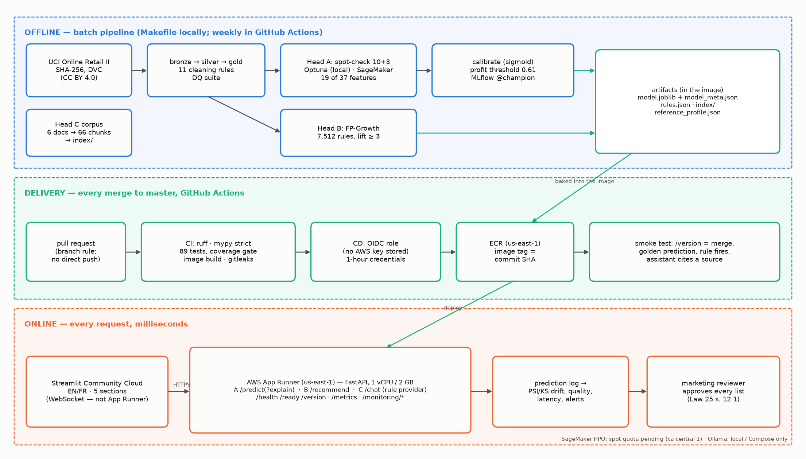
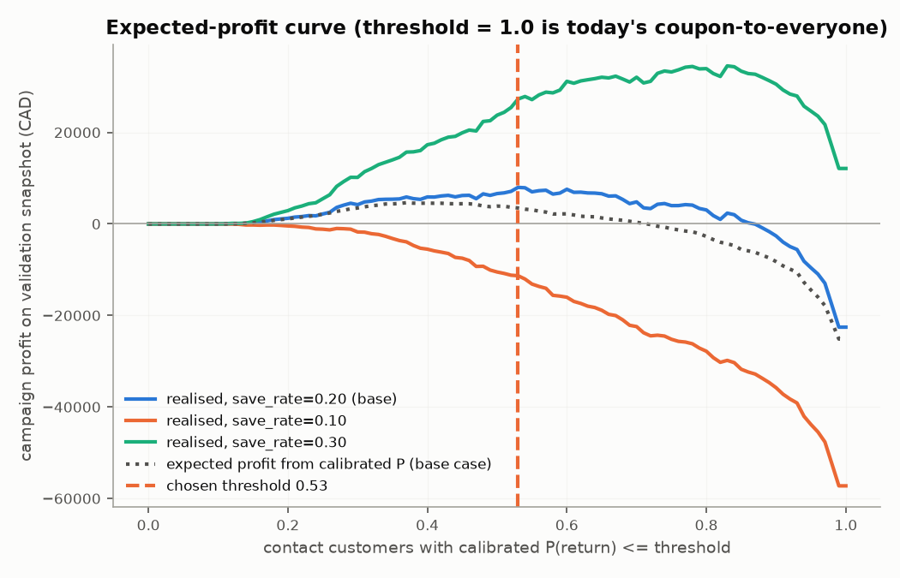
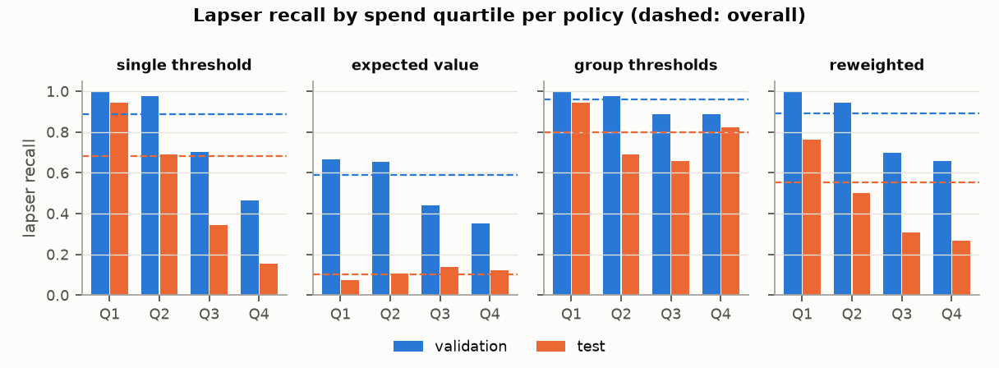

<section class="slide title-slide" markdown="1">

# Boréal Marché — Customer Intelligence Platform

Plateforme d'intelligence client · une chaîne de données, trois modèles, un service gouverné

One data pipeline, three model heads — **retention**, **basket recommendations**, a **bilingual
assistant** — deployed, monitored and governed under Québec's Law 25.

Olga Morgunova · 420-977-VA AI Development Project · Capstone Project 1 · Vanier College

Live: https://boreal-marche-capstone-4ay3m2fn6qdo4jtgy72vpr.streamlit.app · API: https://padp32qm6p.us-east-1.awsapprunner.com/docs 
Recorded talk: https://youtu.be/2bcNpRwMQxE
</section>

<section class="slide" markdown="1">

## Demonstration first

Démonstration d'abord — le système en service, commit 7e67601

1. **Retention** — a customer → P(order in 90 days), the *proposed* coupon, and the three factors
   behind it
2. **Basket** — herb markers → rules fire with their lift; an unknown basket → honest
   "best-sellers" fallback
3. **Assistant** — a question in French → answer with its cited policy; a request for another
   customer's data → refused
4. **Monitoring** — the shifted cohort turns drift red; alerts fired

| Check before the talk | |
|---|---|
| `/version` = deployed commit | `7e67601` |
| `/ready` | 200 |
| Tests in CI | 89, coverage 82% |
| Fallback video | https://youtu.be/C_Qv7lu3cpY |

Boréal Marché · Olga Morgunova2

</section>

<section class="slide" markdown="1">

## The problem: a coupon that loses money

Le problème : un coupon envoyé à tous qui fait perdre de l'argent

Every quarter, a 15% coupon goes to **every** active customer.

−$55,176

result of that policy on the last held-out quarter — mostly discounts given to loyal customers
who would have ordered anyway.

Three client questions, one system:

* **A — Retention:** who is about to stop ordering, and is a coupon worth it?
* **B — Cross-sell:** what else belongs in this basket?
* **C — Support:** answer the 40 recurring questions in FR/EN without inventing anything

Data: UCI Online Retail II, 1,067,371 lines, CC BY 4.0, re-skinned as Boréal Marché.

Boréal Marché · Olga Morgunova3

</section>

<section class="slide" markdown="1">

## Architecture: artifacts cross the line, algorithms do not

Architecture : seuls les artefacts passent du hors-ligne au service en ligne

{: style="max-height:5.9in"}

Boréal Marché · Olga Morgunova4

</section>

<section class="slide" markdown="1">

## Trustworthy data before any model

Des données fiables avant tout modèle

* **11 cleaning rules, counted:** 64,033 lines removed (6.0%); the largest is a
  **22,523-line overlap** between the two yearly sheets that the starter script
  double-counted
* **Point-in-time features:** for cut-off T, features see only orders before T; label = an order in
  [T, T + 90 d)
* **Leakage tested on purpose:** features computed through the label window → PR-AUC
  0.8070 → **1.0000**. A perfect score is a bug — unit tests now fence it off
* **Test set protected:** scored 3 times, each after every choice was fixed, every look
  disclosed

Boréal Marché · Olga Morgunova5

</section>

<section class="slide" markdown="1">

## Head A results: far above the business rule

Rétention : nettement au-dessus de la règle d'affaires

|  | PR-AUC | 95% CI (bootstrap) | ROC-AUC | Brier | Recall@top10% |
| --- | ---: | ---: | ---: | ---: | ---: |
| Model (XGBoost, calibrated) | 0.8472 | 0.832–0.863 | 0.7675 | 0.1916 | 0.161 |
| Baseline: Dummy (prior) | 0.6069 | 0.586–0.625 | 0.5000 | 0.2565 | 0.126 |
| Baseline: rule 'ordered in last 60 days' | 0.6734 | 0.649–0.695 | 0.6187 | 0.2439 | 0.151 |
| Heuristic: recency deciles | 0.7123 | 0.687–0.734 | 0.6563 | 0.2416 | 0.132 |

* Test quarter 2011-09-01, 2,768 customers, **19 features** (of 37:
  the other 18 were unnecessary and are no longer stored)
* Calibrated: ECE 0.041 on test — the probability can be multiplied by dollars
* Ten model families were within noise of each other; tuning added +0.0048. **The
  limit is the features, not the algorithm.**

Boréal Marché · Olga Morgunova6

</section>

<section class="slide" markdown="1">

## Hard decision (1/3): a probability is not a decision

Décision difficile : une probabilité n'est pas une décision

* Coupon if P(return) ≤ **0.61**, the profit-maximising point on validation
* Lapser: `save × (value − discount) − coupon`; loyal: `−(coupon + discount)`
* **First design failed:** valuing a save at 90 days of margin made "contact nobody" optimal —
  the assumption was wrong, not the model
* At a 10% save rate **no** campaign pays

Boréal Marché · Olga Morgunova7

</section>

<section class="slide" markdown="1">

## Hard decision (2/3): one threshold misses the best customers

Un seul seuil oublie nos meilleurs clients

Lapser recall: **89%** overall, **46%** in the top spend quartile.

58 high spenders who did leave were never proposed — **$74,672** of margin.

The model ranks them well; the **single value-blind threshold** is the cause.

Boréal Marché · Olga Morgunova8

</section>

<section class="slide" markdown="1">

## Hard decision (3/3): what I chose, and why

Ce que j'ai choisi, et pourquoi

| Option | Fixes | Costs |
|---|---|---|
| M1 expected value | most profitable | abandons most lapsers; depends on the unmeasured save rate |
| M2 threshold per spend group | closes the gap | 20% more coupons, mostly to customers who stay; treatment set by spend |
| M3 re-weighting | halves the gap | the gain shrinks on test |

**Chosen:** keep one threshold for the automatic proposal **+** a *high-value review list* for the
manager who already approves every list (Law 25 s. 12.1: a person reviews) **+** a randomised 10%
hold-out to measure the save rate per group. The real unknown is the coupon's effect, not the model.

Boréal Marché · Olga Morgunova9

</section>

<section class="slide" markdown="1">

## Heads B and C

Recommandations et assistant bilingue

**B — association rules** (7,512 rules)

* Hit-rate@5 **0.145** vs 0.017 for best-sellers: **8.6×**
* 91.7% of baskets served by a rule; every suggestion names its rule
* Lift trap: confidence 44.7%, lift 2.998 → removed

**C — retrieval + typed tools**

* Tool choice: local LLM **97.5%** golden, **95%** paraphrases
* Rule baseline 100% → **35%** on paraphrases: its keywords overfit
* Out-of-scope refused 100%; never invents a SKU or a probability

Boréal Marché · Olga Morgunova10

</section>

<section class="slide" markdown="1">

## Engineering: deployed, monitored, cheap

Ingénierie : déployé, surveillé, peu coûteux

* CI: ruff, mypy strict, 89 tests, image build, gitleaks
* CD: **OIDC** — no AWS key in GitHub; image tag = commit; smoke test checks `/version`
* Image 823 MB (was 1,437 MB); `/predict` p50 4.8 ms
* Retraining opens a **pull request**, never deploys

* Shifted cohort: 53% of features red, 18 alerts
* Total AWS spend: $3.05
* SageMaker HPO: spot quota pending (case 179073448000753, opened 2026-09-29) — tuning ran locally with Optuna

Boréal Marché · Olga Morgunova11

</section>

<section class="slide" markdown="1">

## Limitations — stated, not hidden

Limites — déclarées, pas cachées

* **Propensity, not uplift:** every dollar rests on a 20% save rate never measured
* **One test quarter**, public re-skinned data; regions are a synthetic mapping
* **One-order customers** are close to coin flips (PR-AUC 0.594)
* **Fairness gap open** — the review list and hold-out are designed, not built
* Live assistant runs the rule provider; hosted LLM never evaluated
* Serving in `us-east-1` (App Runner is not offered in Canada); SQLite log lost on redeploy

Boréal Marché · Olga Morgunova12

</section>

<section class="slide" markdown="1">

## What I would do next

Prochaines étapes

1. **Measure the coupon:** 10% randomised hold-out for two quarters → uplift model
2. **Build the high-value review list** and audit subgroups on backfilled labels
3. **Canada region** (ECS Fargate, `ca-central-1`) and Postgres before any real customer data
4. **Run SageMaker HPO** when the quota is granted; compare cost and score with local Optuna
5. **Onboarding rule** for one-order customers instead of a model that cannot rank them

> Recommendation to the client: stop the blanket coupon; pilot the reviewed, targeted list —
> $120k–$217k a year under stated assumptions.

Boréal Marché · Olga Morgunova13

</section>

<section class="slide title-slide" markdown="1">

# Merci · Thank you — Questions?

Interface : https://boreal-marche-capstone-4ay3m2fn6qdo4jtgy72vpr.streamlit.app

API : https://padp32qm6p.us-east-1.awsapprunner.com/docs

Repository: github.com/OlgaMorgunova/boreal-marche-capstone

Recorded talk / présentation enregistrée : https://youtu.be/2bcNpRwMQxE

</section>
