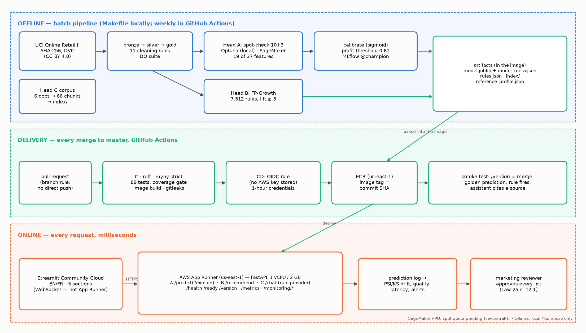
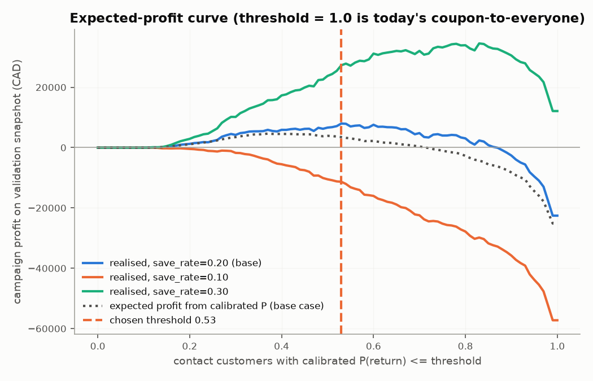
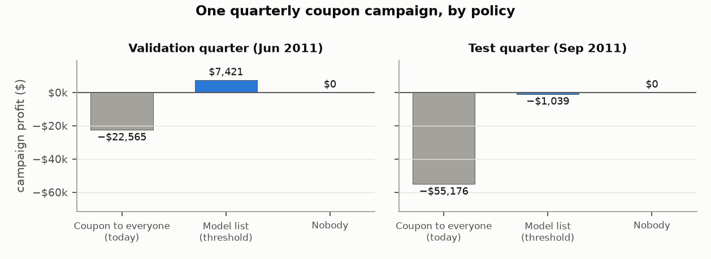
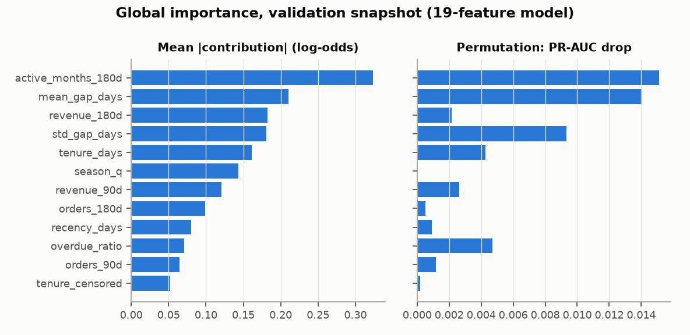
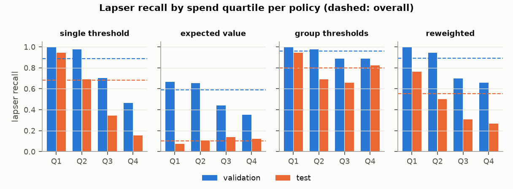

<div class="title" markdown="1">

# Final Technical Report
**Boréal Marché Customer Intelligence Platform** · Capstone Project 1 · D6 (consolidates D2–D5)

Olga Morgunova (individual project) · 420-977-VA AI Development Project · Instructor: Steve Ataky, Ph.D. · Vanier College, LEA.EU · Repository tag `v0.9.6` · KLO 6, 7
</div>

## 1. Overview

Boréal Marché, a (fictional) Québec online grocer, asked three questions: *which active customers
are about to stop ordering, and is the quarterly coupon worth sending them?* (Head A, retention);
*what else belongs in this basket?* (Head B, recommendations); and *can the forty repetitive
customer-service questions be answered, in French or English, without inventing anything?* (Head C,
assistant). This report describes the one system that answers all three as it runs today, how each
design decision was made and tested, and what is still weak. It replaces D2–D5 as the reference
document: where a later deliverable changed an earlier result, only the current result is reported
here and the change is listed in §11.

**The system is live.** Interface: https://boreal-marche-capstone-4ay3m2fn6qdo4jtgy72vpr.streamlit.app · API documentation: https://padp32qm6p.us-east-1.awsapprunner.com/docs · deployed
commit `7e67601`, API 0.9.6, model `0.9.5+xgboost` (checked
2026-11-01, `/ready` = 200). Demonstration video: https://youtu.be/C_Qv7lu3cpY. Recorded D6
presentation (15 minutes, demonstration first): https://youtu.be/2bcNpRwMQxE.

| Question | Result (held-out, temporal) | Baseline | § |
|---|---|---|---|
| Head A — who will order again within 90 days | PR-AUC **0.8472** [0.8317, 0.8626], ECE 0.041, 19 features | 0.7123 recency deciles · dummy 0.607 | 5 |
| Head A — is the coupon worth it | test quarter: **$54,137** better than coupon-to-everyone (−$1,039 vs −$55,176) | today's blanket coupon | 5.5 |
| Head B — basket recommendations | hit-rate@5 **0.145**, 91.7% of baskets served by a rule | 0.017 best-sellers (8.6×) | 6 |
| Head C — assistant | tool choice 97.5% golden / 95% paraphrases (local LLM), out-of-scope refused 100% | rule baseline 100% / **35%** | 7 |
| Platform | `/predict` warm p50 4.8 ms (live 41.8 ms incl. network); image 823 MB; 89 tests, coverage 82% | D3 image 1,437 MB | 8–9 |
| Cost | **$3.05** total AWS spend (2026-09-01 to 2026-11-01) | course target < $25 | 9.3 |
| Fairness | lapser recall 46% in the top spend quartile vs 89% overall — **flagged, not fixed** | — | 10.1 |

*Table 1 — Results. Every number in this report is generated from `reports/metrics/*.json` by
`python -m boreal_marche.reporting.build D6`; none is typed by hand.*

## 2. Problem, data and scope

**Business problem.** Today the client sends a 15% coupon to every customer every
quarter. On the test quarter that policy loses **−$55,176** under the stated cost
assumptions, mostly by discounting loyal customers who would have ordered anyway. The cross-sell
strip is hand-picked, and two employees answer the same questions by e-mail. Success was defined in
D1 as: beat the business rule on PR-AUC and express the gain in dollars; recommendations at least
2.5× better than best-sellers; an assistant that never invents a product or a probability and
refuses what it cannot ground; and a governed, monitored, reproducible deployment under $25.

**Data.** UCI Online Retail II (Chen, 2012, DOI 10.24432/C5CG6D, CC BY 4.0): 1,067,371
invoice lines, 2009-12-01 to 2011-12-09, real UK giftware transactions **re-skinned** as
Boréal Marché (regions and categories mapped, currency shown as $). It is public, pseudonymised data,
not client data, and the conclusions about grocery behaviour are bounded by that (§12). The raw file
is DVC-tracked and verified by SHA-256 (`bcbe73b35f5b…`); it is never committed.

## 3. Architecture


*Figure 1 — The system as built and deployed. Only artifacts cross from the offline pipeline into
the online service; the algorithms never run on a request.*

**Walkthrough.** `make data` downloads and checksums the workbook into **bronze** Parquet; `make
etl` applies eleven ordered cleaning rules into **silver**; `make features` builds **gold**, one row
per (customer, cut-off) with 37 point-in-time features (the model uses 19, §5.4)
and the 90-day label. Head A is selected, tuned, calibrated and thresholded offline and
registered in MLflow as `champion`; Head B mines rules weekly; Head C embeds a 6-document
policy corpus into 66 chunks. Every artifact is baked into one API image, so a deployed
version is one image digest. A pull request runs CI; a merge runs CD, which authenticates to AWS
with a short-lived OIDC token, pushes the image tagged with the commit SHA to ECR, deploys it to App
Runner and smoke-tests the live service. The interface (Streamlit Community Cloud) holds no data and
calls the API over HTTPS. Every prediction is logged, and the monitoring endpoints compute drift,
data quality and latency from that log.

**Why this shape.** Everything expensive — cleaning, mining (241.4 s), tuning — is offline;
everything on the request path is a lookup in a loaded artifact, which is why `/predict` takes
milliseconds (§9.1). Preprocessing lives inside the model artifact so training and serving cannot
drift apart. Rules and the vector index are files with provenance headers, so the API can say which
rule fired and which document it cited.

## 4. Data pipeline and leakage control

| Rule | Rows before | Rows after | Removed | Flagged | Why the rule exists |
| --- | ---: | ---: | ---: | ---: | --- |
| R0 normalise codes | 1,067,371 | 1,067,371 | 0 | 0 | Stock codes/invoices contain trailing spaces and mixed case ('47503J ', 'm'); without normalisation the same SKU is counted twice. |
| R1 drop sheet overlap | 1,067,371 | 1,044,848 | 22,523 | 0 | Both yearly sheets contain 2010-12-01..2010-12-09. Naive concatenation double-counts those orders, inflating frequency and monetary features. |
| R2 drop exact duplicate lines | 1,044,848 | 1,033,034 | 11,814 | 0 | Identical lines (same invoice, SKU, quantity, timestamp, price, customer) are system double-scans; they inflate quantities and basket co-occurrence. Description is not part of the key (spelling variants of one SKU). |
| R3 separate cancellations | 1,033,034 | 1,013,930 | 19,104 | 0 | Invoices prefixed 'C' are reversals, not purchases. Kept in a separate table used only as a point-in-time feature; never netted (netting leaks future events). |
| R4 drop bad-debt adjustments | 1,013,930 | 1,013,924 | 6 | 0 | Invoices prefixed 'A' are accounting adjustments ('Adjust bad debt'). |
| R5 drop non-positive quantity | 1,013,924 | 1,010,531 | 3,393 | 0 | Non-cancellation lines with quantity <= 0 are stock write-offs/damages ('lost', 'damaged', '?') with no customer. |
| R6 drop non-positive price | 1,010,531 | 1,007,910 | 2,621 | 0 | Price <= 0 lines are free samples or manual corrections; they are not sales and would distort monetary features. |
| R7 drop service / fee SKUs | 1,007,910 | 1,003,338 | 4,572 | 0 | Postage, carriage, manual, bank/Amazon fees, test and gift-voucher codes are not products: they would dominate baskets ('recommend postage') and skew category mix. |
| R8 canonicalise descriptions | 1,003,338 | 1,003,338 | 0 | 58,116 | The same SKU appears under several spellings; one canonical label per stock code keeps the rule engine and catalogue consistent. |
| R9 flag + cap outliers | 1,003,338 | 1,003,338 | 0 | 1,642 | Lines above the 99.9% quantile of quantity (520) or line revenue (734.40) — e.g. the 80,995-unit error — are flagged and revenue is capped for features instead of dropped (they are real orders but not representative). Caps are estimated on pre-validation data only. |
| R10 null customer id (Head A view) | 1,003,338 | 776,577 | 226,761 | 226,761 | Guest checkouts cannot be attributed to a customer, so they are excluded from the retention table (Head A) but kept for basket mining (Head B) where the invoice is the unit. |

*Table 2 — Cleaning rules in execution order (`reports/cleaning_report.md`).*

Bronze → silver keeps 1,003,338 of 1,067,371 lines (6.0% removed). The
largest single correction is **R1, the 22,523-line overlap between the two yearly
sheets**: the course's starter script concatenated them and would have double-counted every order
of 1–9 December 2010. The key design decision is **R3: cancellations are separated, not netted** —
netting deletes a purchase made before a cut-off because of a cancellation after it, i.e. future
information in past features. A data-quality suite guards silver and gold in CI; it caught a bug of
mine in R2 (the duplicate key included the description, so two spellings of one product survived)
which is now covered by a unit test.

**Windows.** For a cut-off T, features see only orders before T (observation window
180 days, plus lifetime history); the label is "at least one order in [T, T + 90 d)".
Ninety days matches the client's quarterly campaign and the ~two-month median gap between orders.

| Split | Cutoff T | Eligible customers | Returned within 90 d |
| --- | ---: | ---: | ---: |
| train | 2010-06-01 | 2,652 | 50.0% |
| train | 2010-09-01 | 2,822 | 62.0% |
| train | 2010-12-01 | 3,465 | 38.0% |
| train | 2011-03-01 | 3,338 | 42.4% |
| validation | 2011-06-01 | 2,658 | 50.0% |
| test | 2011-09-01 | 2,768 | 60.7% |

*Table 3 — Snapshots. Train 2010-06-01, 2010-09-01, 2010-12-01, 2011-03-01; validation 2011-06-01 (calibration and
threshold); test 2011-09-01. Label windows never overlap. The base rate moves with the
season, which is why calibration uses its own snapshot.*

**Leakage was tested on purpose** (validation snapshot, untuned model): computing features through
T + 90 days lifts PR-AUC from 0.8070 to **1.0000** — a perfect score, because
recency below 90 days *is* the label. Row-level versus customer-grouped folds differ by only
0.7774 vs 0.7760; grouping is kept as the safe default. Unit tests assert that
adding orders after T changes no feature, and `check_gold` rejects any feature row that saw the
future. Appendix B of the course warns that 0.95 means leakage; the 1.000 above is that warning,
reproduced and fenced off.

## 5. Head A — retention

### 5.1 Evaluation design and model selection

The primary metric is **PR-AUC** of the "returns" class: accuracy is meaningless under a base rate
that moves with the season (Table 3), and ROC-AUC is insensitive to the top of the ranking where money is
spent. Brier and ECE measure the probability, because it is multiplied by dollars. Three baselines
are scored identically: a dummy prior, the client's rule "ordered in the last 60 days", and a
recency-decile heuristic. Ten model families were compared on **identical** preprocessing and
5 customer-grouped folds (selection was done with all 37 features, before the
§5.4 audit):

| Model | PR-AUC (mean ± sd) | ROC-AUC | Brier | Recall@top10% | Fit s |
| --- | ---: | ---: | ---: | ---: | ---: |
| Extra trees | 0.7772 ± 0.0116 | 0.779 | 0.190 | 0.197 | 0.48 |
| XGBoost | 0.7760 ± 0.0129 | 0.778 | 0.190 | 0.195 | 0.55 |
| Logistic regression | 0.7754 ± 0.0111 | 0.780 | 0.189 | 0.195 | 0.10 |
| Random forest | 0.7745 ± 0.0149 | 0.774 | 0.191 | 0.195 | 1.00 |
| MLP (64-32) | 0.7731 ± 0.0137 | 0.775 | 0.191 | 0.195 | 0.50 |
| HistGradientBoosting | 0.7701 ± 0.0124 | 0.771 | 0.193 | 0.193 | 0.31 |
| LightGBM | 0.7695 ± 0.0131 | 0.771 | 0.194 | 0.194 | 0.37 |
| k-NN (k=50) | 0.7581 ± 0.0136 | 0.754 | 0.198 | 0.194 | 0.05 |
| Gaussian naive Bayes | 0.7438 ± 0.0151 | 0.745 | 0.287 | 0.191 | 0.06 |
| Decision tree | 0.7388 ± 0.0157 | 0.755 | 0.200 | 0.189 | 0.16 |
| Heuristic: recency deciles | 0.5823 ± 0.0181 | 0.641 | 0.235 | 0.140 | 0.00 |
| Baseline: rule 'ordered in last 60 days' | 0.5383 ± 0.0181 | 0.608 | 0.238 | 0.139 | 0.00 |
| Baseline: Dummy (prior) | 0.4731 ± 0.0072 | 0.500 | 0.249 | 0.123 | 0.00 |

*Table 4 — Spot-check (12,277 training rows, cross-validation).*

Every learned model beats every baseline by at least 0.16 PR-AUC, and the top is flat: 7
families lie within one standard deviation (0.0116) of the best, logistic regression
included. Model choice matters less than features and decision design. Extra trees and XGBoost were
tuned with Optuna (TPE, median pruning, 40 trials each): the gain was
**+0.0048** for XGBoost and +0.0007 for extra trees — less than
one fold standard deviation. I report this as a finding, not a failure: the problem is limited by
the information in the features, not by hyper-parameters. XGBoost won on validation
(0.8047 vs 0.7994).

### 5.2 Calibration

| Method (5-fold out-of-fold on validation) | Brier | Log-loss | ECE |
| --- | ---: | ---: | ---: |
| none | 0.1890 | 0.5558 | 0.036 |
| sigmoid | 0.1879 | 0.5522 | 0.012 |
| isotonic | 0.1889 | 0.5581 | 0.017 |

*Table 5 — 5-fold out-of-fold calibration on the validation snapshot.*

Sigmoid (Platt) scaling was chosen: lowest Brier, ECE 0.036 → **0.012**, monotone and
smooth at the threshold (isotonic produces ties with ~2.7k rows). On the test quarter ECE is
0.041, so calibration survives the seasonal shift.

### 5.3 From a probability to a decision — the hard decision

A probability is not a decision. The coupon goes to customers whose calibrated P(return) is **at or
below** a threshold. Per contacted customer the expected profit is `save_rate × (value − discount) −
coupon` for a lapser and `−(coupon + discount)` for a customer who would have returned anyway, with
$4.00 handling, a 15% discount, a stated save rate of 20% and a
365-day value horizon at 30% margin (`params.yaml → business`).


*Figure 2 — Validation campaign profit by threshold for three save rates; threshold 1.0 is today's
coupon-to-everyone.*

The profit-maximising threshold on validation is **0.61**: it contacts
1,811 of 2,658 customers, reaches 1,178 of 1,330
lapsers and earns $7,421, against −$22,565 for coupon-to-everyone. The model's
first value is **not sending** 32% of coupons.

| Assumption | Profit-maximising threshold | Max validation profit |
| --- | ---: | ---: |
| save rate = 0.10 | 0.00 | $0 |
| save rate = 0.20 | 0.61 | $7,421 |
| save rate = 0.30 | 0.78 | $33,797 |
| save rate 0.20, value horizon 90 d (first design) | 0.00 | $0 |

*Table 6 — Sensitivity. At a 10% save rate no campaign pays; the dollar figures rest on an
assumption that has never been measured.*

**Negative result.** I first valued a saved customer at one 90-day window of margin. Every
threshold then lost money and the optimum was "contact nobody" — the 15% discount is as large as one
quarter's margin of a small customer. The assumption, not the model, was wrong: saving a lapser
restores a relationship. It was replaced by a stated 365-day horizon, and both versions are kept in
`train_final.json`. The deeper lesson, which drives §10.1, is that the threshold — not the model —
decides who gets the offer, and one threshold treats a $50 customer and a $5,000 customer alike.

### 5.4 Data minimisation and the served model

Law 25 requires that only necessary information be collected. The rule was written before the test:
a feature group whose removal costs less than 0.005 PR-AUC is not necessary. Each group was removed
in turn on the same folds:

| Group | Features | CV PR-AUC loss | Validation loss | Folds worse | Decision | Why audited |
|---|---|---|---|---|---|---|
| time of day | `weekend_share_180d`, `mean_order_hour_180d` | -0.0001 | +0.0000 | 3/5 | **remove** | When a person shops (weekend, hour) is behavioural profiling beyond what a re-order prediction needs. |
| region | `region` | -0.0001 | -0.0002 | 3/5 | **remove** | Needed for delivery; as a model input it is a proxy for geography. |
| cancellations | `cancel_lines_180d`, `cancel_rate_180d` | +0.0001 | +0.0001 | 4/5 | **remove** | Dissatisfaction signal. |
| category mix | `share_seasonal`, `share_kitchen`, `share_home_decor`, `share_bags_wrap`, `share_lighting`, `category_entropy_180d` | -0.0002 | +0.0001 | 2/5 | **remove** | What kind of products a person buys. |
| basket shape | `lines_per_order_180d`, `units_per_line_180d`, `distinct_skus_180d`, `sku_repeat_rate_180d` | +0.0000 | -0.0002 | 3/5 | **remove** | Size and breadth of orders. |
| outlier lines | `outlier_line_share_180d` | +0.0000 | -0.0003 | 4/5 | **remove** | Bulk-buying flag. |
| lifetime value | `revenue_lifetime`, `orders_lifetime` | +0.0008 | +0.0016 | 4/5 | **remove** | Long-run value; grows with observable history (monitoring finding, D4). |

*Table 7 — Minimisation ablation (loss = full minus reduced PR-AUC).*

No group was necessary; removing all 18 together cost 0.7809 →
0.7802 in CV. The served model `0.9.5+xgboost` reads **19 features**
(`recency_days`, `tenure_days`, `tenure_censored`, `orders_30d`, `orders_90d`, `orders_180d`, `active_months_180d`, `revenue_30d`, `revenue_90d`, `revenue_180d`, `aov_180d`, `max_order_value_180d`, `mean_unit_price_180d`, `mean_gap_days`, `std_gap_days`, `overdue_ratio`, `orders_trend`, `revenue_trend`, `season_q`); the other fields are no longer stored by the API. Because the promotion gate
required beating the champion, I added a minimisation clause (strictly fewer features, loss ≤ 0.005)
and every gate passed:

| Gate | Result |
|---|---|
| beats best baseline by 0.05 pr auc | pass |
| calibrated brier not worse than raw | pass |
| ece at most 0.05 | pass |
| beats champion by 0.005 pr auc or minimises | pass |
| fairness gap within limit or not worse | pass |

*Table 8 — Promotion gates for the served model (`docs/MLFLOW_PROMOTION_POLICY.md`).*

### 5.5 Held-out test results

Test snapshot 2011-09-01: 2,768 customers, base rate 60.7%. The test set has
been scored **3 times**, each after every choice was fixed: look 1 before the R2
duplicate fix (0.8504), look 2 after the re-run (identical), look 3 for the minimised
model. No decision in this report used test data.

|  | PR-AUC | 95% CI (bootstrap) | ROC-AUC | Brier | Recall@top10% |
| --- | ---: | ---: | ---: | ---: | ---: |
| Model (XGBoost, calibrated) | 0.8472 | 0.832–0.863 | 0.7675 | 0.1916 | 0.161 |
| Baseline: Dummy (prior) | 0.6069 | 0.586–0.625 | 0.5000 | 0.2565 | 0.126 |
| Baseline: rule 'ordered in last 60 days' | 0.6734 | 0.649–0.695 | 0.6187 | 0.2439 | 0.151 |
| Heuristic: recency deciles | 0.7123 | 0.687–0.734 | 0.6563 | 0.2416 | 0.132 |

*Table 9 — Test metrics with 95% bootstrap intervals.*

The model beats the best heuristic by **+0.1350 PR-AUC** with non-overlapping
intervals. PR-AUC of the lapse class, the class the campaign acts on, is 0.6438.


*Figure 3 — One quarterly campaign by policy on the two held-out quarters.*

On the test quarter the validation threshold contacts 1,212 customers and roughly
breaks even (−$1,039), against −$55,176 for coupon-to-everyone:
**$54,137 better than the status quo per quarter** (validation quarter: $29,986).
Annualised over four campaigns that is **$120k–$217k a year**, under the
stated assumptions. It does **not** beat "contact nobody" on the test quarter: with a 60.7% base rate
few customers are worth a coupon. The per-customer expected-value policy stays positive
($2,150) because it adapts to each probability — but it reaches far fewer lapsers
(§10.1).

### 5.6 Where the model fails, and why it decides what it decides

| Segment | n | Return rate | PR-AUC | Lapser recall | Selection rate | Recall gap vs overall |
| --- | ---: | ---: | ---: | ---: | ---: | ---: |
| region: ON | 228 | 69.3% | 0.864 | 0.600 | 36.8% | -8.2 pts |
| region: QC | 2,500 | 60.2% | 0.847 | 0.690 | 44.5% | +0.8 pts |
| tenure band: 6-12 months | 445 | 62.5% | 0.845 | 0.695 | 46.1% | +1.3 pts |
| tenure band: <6 months | 686 | 46.4% | 0.696 | 0.851 | 71.1% | +16.9 pts |
| tenure band: >12 months | 1,637 | 66.2% | 0.880 | 0.566 | 31.7% | -11.6 pts |
| spend quartile: Q1 (low) | 763 | 40.6% | 0.520 | 0.943 | 91.1% | +26.1 pts |
| spend quartile: Q2 | 702 | 53.1% | 0.682 | 0.690 | 55.0% | +0.8 pts |
| spend quartile: Q3 | 650 | 66.8% | 0.846 | 0.343 | 16.5% | -33.9 pts |
| spend quartile: Q4 (high) | 653 | 86.2% | 0.961 | 0.156 | 3.7% | -52.6 pts |
| frequency band: 1 order | 1,280 | 44.0% | 0.594 | 0.877 | 80.2% | +19.5 pts |
| frequency band: 2-3 orders | 897 | 65.8% | 0.803 | 0.358 | 19.8% | -32.4 pts |
| frequency band: 4+ orders | 591 | 89.2% | 0.970 | 0.047 | 1.2% | -63.5 pts |

*Table 10 — Test performance by segment (n ≥ 50).*

Ranking collapses for **one-order customers** (PR-AUC 0.594, n = 1,280) and the
lowest spend quartile (0.520): with one purchase there is no cadence to learn from. The
decision fails differently: lapser recall is 0.943 in the lowest spend quartile but
**0.156 in the highest** (§10.1).


*Figure 4 — Global importance on validation: mean |TreeSHAP| and permutation drop.*

The first factor is `active_months_180d` (months with an order out of the last six) for 50%
of customers. Permutation drops are small everywhere (≤ 0.015) because cadence and
frequency features are correlated: importance is shared by a cluster of habits. Each prediction can
return its exact factors (`POST /predict?explain=3`): XGBoost contributions in log-odds, scaled by
the Platt slope so they add up to the calibrated probability (error 4.2e-06). Directions
agree with domain expectations for 6/6 audited features, and the top-3 set is stable under
±5% input noise for 70% of customers. The factors are shown to the reviewer always and to
a customer only on request, with the sentence "this describes how the model weighed your order
history, not why you order".

## 6. Head B — basket recommendations

32,126 invoices × 4,466 items at density 0.54%: a sparse matrix takes
3.8 MB instead of 136.8 MB. Rules were preferred over collaborative
filtering because the question is basket-conditional, 22.6% of lines are guests with no
history, and every suggestion must say *why*. Parameters were swept on a slice inside the mining
period; the chosen point (support 0.005, i.e. ≥ 161 invoices,
confidence 0.2, lift ≥ 3) gives **7,512 rules**. An honest surprise: in
mlxtend, FP-Growth is 116× *slower* than Apriori at this size (pure-Python recursion vs
vectorised NumPy); FP-Growth stays the production miner because it is offline and identical
itemsets are asserted in code.

**The lift trap, from this data.** 22294 HEART FILIGREE DOVE SMALL → 85123A WHITE HANGING HEART T-LIGHT HOLDER has confidence 44.7%
but lift 2.998: the consequent is the best-seller, in 14.9% of all
baskets, so the rule only says "people who buy anything buy the best-seller". The lift floor
removes it.

| Strategy (temporal holdout, 6,897 baskets) | Hit-rate@5 | Basket coverage |
|---|---:|---:|
| Rules + popularity fill (served) | **0.145** | 91.7% |
| Global popularity baseline | 0.017 | 100% |

*Table 11 — 8.6× the baseline (course "excellent": ≥ 2.5× with coverage > 40%).*

At serving time rules are indexed by antecedent item; the response names the rule that fired, and
an unmatched basket returns `popularity_fallback` with the unknown items listed, so the interface
never presents a best-seller as a personal suggestion. Example: [22916, 22918] →
22917 HERB MARKER ROSEMARY (rule, lift 147); 22920 HERB MARKER BASIL (rule, lift 140); 22919 HERB MARKER MINT (rule, lift 140).

## 7. Head C — grounded bilingual assistant

Retrieval-augmented generation was chosen over fine-tuning because policies change and every answer
must cite a source. 6 documents (4,995 words, EN + FR) are chunked into
66 chunks and embedded with a multilingual model, so a French question retrieves an
English chunk. The language model is the **interface, not the source of truth**: four typed tools —
`policy_search`, `retention_score` and `recommendations` (which call this API's own endpoints) and
`product_lookup` — return validated objects. Guardrails run around every provider: another
customer's data is refused before any model runs; a policy answer below similarity 0.30
is handed to a human; an LLM answer mentioning a SKU or percentage absent from the tool output is
replaced by the verified template.

| Question set | Provider | Tool choice | Source cited | OOS refused | False refusals | Latency p50 | Cost/query |
|---|---|---|---|---|---|---|---|
| golden (40) | rule | 100.0% | 95.0% | 100.0% | 0.0% | 4 ms | $0.0000 |
| golden (40) | ollama | 97.5% | 90.0% | 100.0% | 3.2% | 1553 ms | $0.0000 |
| golden | openai | not run: OPENAI_API_KEY not set |  |  |  |  |  |
| paraphrase (20) | rule | 35.0% | 22.2% | 80.0% | 73.3% | 0 ms | $0.0000 |
| paraphrase (20) | ollama | 95.0% | 88.9% | 100.0% | 6.7% | 1282 ms | $0.0000 |
| paraphrase | openai | not run: OPENAI_API_KEY not set |  |  |  |  |  |

*Table 12 — Assistant evaluation on a 40-question golden set written before the assistant and 20
paraphrases written after the rule provider.*

The rule baseline scores 100% on the golden set and 35% on paraphrases: its
keywords were written by someone who had read the golden questions. The local model (Ollama,
llama3.1:8b) holds up at 97.5% / 95%. That gap is the measured case for a
language model. The hosted provider is implemented but **not evaluated** (no API key; course §8.5
also forbids sending personal data to it). The live service runs the rule provider, because an 8B
model needs a GPU instance ($384/month); the local model runs in the Compose stack.

## 8. Deployment and MLOps

### 8.1 Containers, CI and CD

The API image is multi-stage, pinned by digest, runs as non-root UID 10001, has a `HEALTHCHECK` on
`/ready`, and installs a serving-only lock (`xgboost-cpu`, no training stack): **823 MB**, down from
1,437 MB at D3, while also carrying the assistant and its embedding model.

CI (`.github/workflows/ci.yml`) runs on every pull request: ruff, mypy `--strict`, 89
tests with a 70% coverage gate (currently 82%, including the API contract and a
golden-prediction regression test), the data-quality suite, the assistant tool-choice evaluation,
both image builds with their sizes, a container smoke test, and gitleaks over the full history.
CD (`cd.yml`) runs on merge: GitHub OIDC → role `BorealGithubDeploy` (one-hour credentials, trust
limited to this repository's immutable IDs and the `production` environment) → image tagged with the
commit SHA → ECR → App Runner → `scripts/smoke_test.py`, which fails the run unless `/version`
equals the merged commit and the golden prediction is reproduced. **No AWS key exists in GitHub.**
The OIDC set-up failed twice, and each failure was debugged from CloudTrail evidence (the subject
claim carries immutable IDs; a `PassRole` condition App Runner does not send).

### 8.2 Hosting decisions and their cost

The API runs on AWS App Runner (1 vCPU / 2 GB, 765.4MiB at idle). The interface could not follow:
App Runner's proxy rejected Streamlit's WebSocket upgrade (a `403` from `envoy` that never reached
the container), so it runs on Streamlit Community Cloud. **Region deviation:** App Runner is not
offered in `ca-central-1`, so serving runs in `us-east-1`. That is acceptable for public,
pseudonymised data; for real customers it would be a transfer outside Québec (Law 25 s. 17), and the
same image would run on ECS Fargate in `ca-central-1` (~$30/month more, mostly the load balancer).

### 8.3 Monitoring and retraining

A Locust traffic simulation (adapted from the course lab) replays the held-out customers, then a
deliberately shifted cohort (recent Maritimes sign-ups, short histories, unseen SKUs):

| Check | After normal traffic | After shifted cohort | Measure |
|---|---|---|---|
| input drift | amber (0.000) | red (0.528) | share of features with PSI >= red |
| prediction drift | green (0.031) | red (2.250) | PSI of p_return |
| data quality | green (0.048) | red (0.996) | max(missing-rate change, /predict 422 rate) |
| error rate | green (0.000) | green (0.000) | share of 5xx responses |
| latency p95 predict | green (21.574) | green (21.839) | ms, server-side |
| rule fire rate | green (0.618) | green (0.531) | share of non-empty baskets answered by a rule |

*Table 13 — Traffic lights after each phase (`docs/MONITORING.md` states the thresholds).*

Under the shifted cohort 53% of features cross PSI 0.25, 43% of basket
items are unknown and the rule fire rate falls from 92% to 53%; each level
change raised an alert (18 in total). **A correction found by monitoring:** with the
pooled training data as the reference, healthy traffic was permanently red, because later snapshots
have longer histories by construction; a monitor that is always red is ignored, so the reference is
now the calibration snapshot. **Delayed ground truth:** the label exists 90 days after a prediction;
a weekly backfill joins predictions to later orders, and until then drift and data quality are the
leading indicators. The weekly retraining workflow re-runs the pipeline and the promotion gates
(including fairness and minimisation) and **opens a pull request — it never deploys**; a human
merges.

### 8.4 Managed training (SageMaker)

The Service Quotas request for `ml.m5.large` spot training in `ca-central-1` (case 179073448000753, opened 2026-09-29) was still open when this report was built, so **no managed job has run** and none is reported. All tuning used the local Optuna backend (40 trials per model, 1.6 min for XGBoost, $0). The SageMaker path is implemented and tested short of AWS: the script-mode entry point (`retention/sm_train.py`) reproduces the local CV score, the self-contained source directory runs with `python -I`, and `python scripts/run.py hpo --provider aws --dry-run` prints the job (Bayesian, 20 jobs, 2 parallel, managed spot, `max_run` 15 min, `max_wait` 30 min). When the quota is granted, the run writes `reports/metrics/cloud_hpo_evidence_aws.json` and this section is regenerated with its numbers.

**When managed training would pay off.** One local trial takes ~2 s (5 folds × 12k rows); a
SageMaker job spends ~3 minutes starting its container. Managed training wins when trials take
tens of minutes (≈ 100× the data, or deep models), need more memory than a laptop, must run
unattended, or the data may not leave the cloud account. None applied here.

## 9. Optimisation

### 9.1 Latency

| Endpoint | First call before / after | Warm p50 / p95 before | Warm p50 / p95 after | Server p50 | p50 change |
|---|---|---|---|---|---|
| `/predict` | 17.8 / 9.3 | 7.8 / 9.9 | 4.8 / 7.6 | 6.9 → 3.9 | 39% |
| `/predict/batch (100)` | 18.8 / 12.5 | 13.7 / 16.0 | 9.2 / 11.4 | 11.2 → 7.5 | 33% |
| `/products` | 11.2 / 4.3 | 10.2 / 12.6 | 2.4 / 3.1 | 9.4 → 1.8 | 77% |
| `/recommend` | 4.5 / 3.6 | 1.2 / 1.7 | 1.2 / 1.6 | 0.7 → 0.7 | 1% |
| `/chat policy (rule)` | 11.6 / 9.0 | 6.5 / 7.9 | 6.7 / 7.4 | — | -2% |
| `/chat retention tool (rule)` | 16.9 / 13.4 | 11.6 / 15.4 | 7.6 / 10.9 | — | 34% |
| `/monitoring/report` | 51.1 / 53.0 | 115 / 121 | 0.9 / 1.1 | 114 → 0.3 | 99% |

*Table 14 — Latency by endpoint, ms, before (v0.9) and after the D5 changes, same machine.*

Each change followed a measurement: building the one-row model input column-wise instead of through
pandas (7.8 → 4.8 ms p50 for `/predict`), folding catalogue
accents once at start-up, caching the monitoring report for 10 s (115 →
0.9 ms), and a warm-up before `/ready` turns 200. **Cold start was not improved**
(5.8 s for the container): most of it is Python importing scientific libraries. On App
Runner the network round trip (`/health` alone 30.3 ms) dominates every handler; the real latency lever for users is
region, not code.

### 9.2 Scalability

One worker saturates at ~222 predictions/s locally (~111/s assumed on an
App Runner vCPU); batch scoring reaches 10,200 rows/s. The first hard limit is the
per-instance SQLite prediction log (one writer, lost on redeploy); Postgres is already in the
Compose stack. Rules scale linearly (480,768 rules → 46 ms p95), retrieval is
brute force and free at 66 chunks (89 ms at a million), and the monitoring
report grows with its window (1208 ms at 50,000 predictions) until it is pre-aggregated.

### 9.3 Cost

| Service | Spend (USD) |
|---|---|
| AWS App Runner | $2.61 |
| Tax | $0.40 |
| Amazon EC2 Container Registry (ECR) | $0.04 |

*Table 15 — Total AWS spend $3.05 (2026-09-01 to 2026-11-01, Cost Explorer). A $10 budget alarm
has been active since Week 1.*

The service costs $10.22/month while provisioned and idle and is paused between grading
windows. At realistic volumes the fixed memory charge dominates: about $0.000195
of compute per 1,000 predictions at full load. Assistant queries cost $0.23 per 1,000 on a
dedicated GPU (local model, the only one allowed to see personal data) or an unverified
$0.19 with the hosted provider.

## 10. Responsible AI and Law 25

### 10.1 Fairness: the gap I found and what I recommend

Lapser recall — the share of customers who did lapse who were proposed for the offer — is
89% overall but **46% in the top spend quartile** (validation; flagged
groups: `tenure_band=>12m`, `spend_quartile=Q3`, `spend_quartile=Q4 (top)`). 58 top-spend lapsers were not proposed, worth
$74,672 of margin. The model is not wrong about them (its PR-AUC there is among the
highest); the **single threshold** is: high spenders rarely lapse, so their probabilities are high
and one value-blind cut-off reaches few of those who do. Removing 18 features neither caused nor
fixed the gap (v0.9 gap 52 points).

| Policy | PR-AUC (val) | Coupons val / test | Lapser recall | Top-quartile recall | Worst gap | Campaign profit val / test |
|---|---|---|---|---|---|---|
| M0 single threshold | 0.805 | 1,814 / 1,212 | 0.89 / 0.68 | 0.46 / 0.16 | 0.43 / 0.53 | $7,695 / −$1,039 |
| M1 expected value | 0.805 | 1,174 / 193 | 0.59 / 0.10 | 0.35 / 0.12 | 0.24 / 0.10 | $13,038 / $2,150 |
| M2 group thresholds | 0.805 | 2,182 / 1,662 | 0.96 / 0.80 | 0.89 / 0.82 | 0.07 / 0.14 | −$526 / −$17,960 |
| M3 reweighted | 0.805 | 1,848 / 953 | 0.89 / 0.55 | 0.66 / 0.27 | 0.23 / 0.28 | $6,763 / −$1,778 |

*Table 16 — Four policies, chosen on validation and scored once on test.*


*Figure 5 — Lapser recall by spend quartile under each policy.*

No mitigation dominates: expected value (M1) is most profitable but abandons most lapsers; group
thresholds (M2) close the gap but send 20% more coupons to high spenders who would have returned
and set different treatment by spend; re-weighting (M3) halves the gap but the gain shrinks on test.
**Recommendation:** keep the single threshold for the automatic proposal; add the customers M2
would add as a separate **high-value review list** for the marketing reviewer, who already approves
every list; and run a **randomised 10% hold-out** for two quarters to measure the save rate per
quartile — the unknown on which every dollar figure and every mitigation depends. Neither the
review list nor the hold-out is built yet (§13).

### 10.2 Law 25 governance

`GOVERNANCE_LOI25.md` holds the register of automated decisions (D-A coupon targeting, D-B
recommendations, D-C assistant answers and hand-off), the customer notice in French and English
(shown in the interface), the data-minimisation audit (§5.4), and the retention schedule (raw
transactions 2 years, prediction log 13 months then aggregated, last 5 model versions; deletion
requests honoured within 30 days). **Design consequence of s. 12.1:** a decision based exclusively
on automated processing must be disclosed with its principal factors and be reviewable by a staff
member. The API therefore returns a *proposal* and a person approves every campaign list, so the
decision is not exclusively automated, and the factors are available for each customer. The CAI's
published guidance was read on 2026-11-01; `MODEL_CARD.md` and `DATA_CARD.md` record intended and
out-of-scope uses, subgroup results and known failure modes.

## 11. What changed since the earlier submissions

| Earlier document | What it said | What is true now, and where |
|---|---|---|
| D2 architecture | design figure with Head C, monitoring and interface "not yet built" | all built and deployed: Fig. 1 replaces it (§3) |
| D3 §7–8 | threshold 0.56 from an earlier run; test policy figures for that run | the served artifact's threshold is reported; with the 19-feature model it is 0.61, and every policy figure here uses it (§5.3, §5.5) |
| D3 §8 | 37-feature model, test PR-AUC 0.850 | 19-feature model 0.847 [0.832, 0.863], third test look disclosed (§5.4–5.5) |
| D3 §11 | SageMaker as a "control point" with planned numbers | status stated plainly; no managed-run number is claimed (§8.4) |
| D3 §14 | Head C not built; image 2.2 GB | Head C built and evaluated (§7); image 823 MB (§8.1) |
| D4 §1 | live URLs, CD run and video PENDING | live and checked 2026-11-01 (§1) |
| D4 §7 | `/predict` p95 ~50 ms through Docker | traced to Docker Desktop's port proxy on Windows; 4.8 ms warm p50 locally, network-bound live (§9.1) |
| D4 §7 | drift reference = pooled training data | calibration snapshot; always-red monitor corrected (§8.3) |
| D2/D3 | Law 25 articles "to be verified" | CAI guidance read and cited; design checked against it (§10.2) |
| D3 §9, D4 §5 | spend-quartile recall gap noted | audited, four mitigations scored, recommendation made (§10.1) |

## 12. Limitations

* **Propensity, not uplift.** The model predicts who returns, not who returns *because of* the
  coupon. Every dollar figure rests on a save rate of 20% that has never been measured;
  at 10% no campaign pays.
* **One test quarter**, at a higher base rate than training; seasonality is seen once.
* **Public, re-skinned data.** Regions are a synthetic mapping, so regional fairness results
  describe the mapping; the catalogue is giftware bought largely by businesses.
* **Weak for new customers.** One-order customers are close to coin flips (§5.6).
* **Fairness gap open** in the top spend quartile; the recommended review list and hold-out are not
  built.
* **Operations.** The live prediction log is per-instance SQLite and lost on redeploy; the live
  assistant runs the rule provider (35% on paraphrases); the hosted LLM provider is unevaluated;
  serving runs outside Canada; cold start 5.8 s; the SageMaker job has not run (quota).
* **Legal check.** Article numbers in the governance file follow the CAI's guidance; the consolidated
  text on LégisQuébec refused automated reading and is checked by hand.

## 13. What I would do next

1. **Measure the coupon's effect**: a randomised 10% hold-out for two quarters, then an uplift model
   if the effect differs by customer. This is the single largest source of uncertainty.
2. **Build the high-value review list** in the interface and the backfilled subgroup audit, then
   decide between M0 and M1 on measured save rates.
3. **Move serving to `ca-central-1`** (ECS Fargate) and the prediction log to Postgres (RDS) before
   any real customer data.
4. **Run the SageMaker HPO job** as soon as the quota is granted, and report its cost and score
   against local Optuna.
5. **Onboarding rule for one-order customers** instead of a model that cannot rank them.

## 14. Reproducibility

```
git clone https://github.com/OlgaMorgunova/boreal-marche-capstone.git && cd boreal-marche-capstone
docker compose -f docker/compose.yml up --build -d    # API :8000/docs, UI :8501, Postgres, Ollama
python3 scripts/smoke_test.py --api http://127.0.0.1:8000 --ui http://127.0.0.1:8501
make setup-pinned && make all && make test            # every artifact from the raw data (~15 min)
python -m boreal_marche.reporting.build D6 D6-ES D6-DECK
```

Windows, step by step from an empty machine: `docs/RUN_FROM_ZERO_WINDOWS.md`. Every parameter
(windows, cut-offs, costs, grids, seed 42) is in `params.yaml`; every run is tracked in
MLflow with its git commit and data checksum. Repository tags: `v0.1`, `v0.2`, `v0.3`, `v0.9`, `v0.9.5`.

## 15. Sources and AI-tool use

Chen (2012), UCI Online Retail II, CC BY 4.0. Commission d'accès à l'information du Québec, "Vos
droits" and "Principaux changements de la Loi 25" (read 2026-11-01); Act respecting the protection of
personal information in the private sector, CQLR c. P-39.1. Huyen, *Designing Machine Learning
Systems*; Lundberg & Lee (2017) for SHAP; Hardt et al. (2016) for equal opportunity. Documentation of
scikit-learn, XGBoost, Optuna, MLflow, mlxtend, FastAPI, AWS App Runner, ECR and GitHub OIDC. Course
Locust lab (instructor material).

AI-assisted coding and drafting tools were used for code, tests, the policy corpus and the text of
every deliverable; I reviewed each module and can explain every line. **Where AI-generated output
had to be corrected**, each found by a test or a measurement: the 90-day value horizon (§5.3); the
duplicate key including descriptions (§4); `mean_gap_days` computed between invoices rather than
order days (`overdue_ratio` reached 253,881); the pooled drift reference (§8.3); a test that hid the
SKU guardrail by stripping spaces from streamed tokens; a Docker clean-up step that deleted
`numpy/_core/tests` and crashed the container; `season_q` presented as a reason in explanations; a
parallel loader presented as a cold-start fix until measurement showed no gain; and a promotion check
that compared against the registry alias instead of the served artifact.
